# CXL Memory Tiering Lab：從建置到核心追蹤

這份教學從 NUMA 與 CXL 記憶體的關係出發，建立 QEMU／Linux Guest，再追蹤一個匿名頁如何配置、移動、驗證與撤離。所有函式、檔名和實驗參數都對應目前專案的 M0–M4 實作。

預備知識：能閱讀 C/C++、使用 Linux shell，知道指標、虛擬記憶體與程序的基本概念。尚未接觸 NUMA、CXL、tracefs 或 Linux MM 原始碼，也可以依序閱讀。

文件以本檔為主；[離線 HTML](cxl-mm-tutorial.html) 由相同內容產生。技術範圍與驗收條件見[實作規格](../cxl_memory_tiering_codex_implementation_v2.html)，常用命令見 [README](../README.md)。圖表使用 GitHub 支援的 Mermaid；HTML 已將圖表轉為內嵌 SVG，閱讀時不需網路或 JavaScript。

## 目錄

- [0. 閱讀路線與證據邊界](#reading)
- [1. NUMA、CXL 與位址：先建立系統模型](#memory-model)
- [2. 從乾淨 Host 建置](#build)
- [3. Host／Guest 的執行架構](#architecture)
- [4. M1：配置、移頁與資料完整性](#migration)
- [5. 沿著一次移頁追原始碼](#trace-code)
- [6. Policy：熱度、容量與重試](#policy)
- [7. 評估設計：避免把結果算得過好](#evaluation)
- [8. 撤離：從 managed pages 到 block offline](#drain)
- [9. 用 trace 核對實際執行](#trace-runtime)
- [10. 工具練習：從問題選擇觀測方式](#tools)
- [11. BUG 定位：完整案例與排查路徑](#bugs)
- [12. 自問自答與延伸練習](#exercises)
- [13. 名詞、來源與文件維護](#references)

<a id="reading"></a>

## 0. 閱讀路線與證據邊界

先完成建置與第一次開機，再閱讀一批移頁的輸入、syscall 與 query，最後加入 policy 與撤離。每一步都應能指出「送出了什麼要求」、「哪份紀錄證明實際發生」和「失敗時在哪裡停止」。

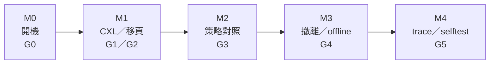

| 讀到這裡 | 應能完成的操作 | 應能解釋的原因 |
|---|---|---|
| 第 1–3 章 | 建出映像、啟動指定 Guest、找到 run 目錄 | Host、Guest、overlay 與 CXL backend 的責任不同 |
| 第 4–5 章 | 追到 `move_pages` 的 query／move 分支 | VA 不變，實體頁的位置可以改變；回傳值不等於最終位置 |
| 第 6–7 章 | 讀出一輪 counts、before、after 與指標 | 本輪存取與輪末調整有時序關係，不能倒算命中率 |
| 第 8–9 章 | 解釋 offline 的前置條件、核對一批 trace | managed mapping 撤離和整個 memory block 下線是兩層驗證 |
| 第 10–12 章 | 沿第一個失敗邊界提出並驗證假設 | CLI 錯誤、syscall errno、kernel warning 不應混成同一原因 |

### 先分辨四種證據

| 類型 | 能證明什麼 | 不能據此推論什麼 |
|---|---|---|
| `make doctor` | Host 工具、資源、一般使用者 KVM API／空 VM 能力 | Guest 已成功開機 |
| FakeMigrator／MockSysfs | 指定 partial failure、重試與 rollback 條件下的控制邏輯 | 真實核心已發生相同故障 |
| 真實 Guest raw evidence | 該次 binary、image、kernel 下的 query、syscall、sysfs 與 trace | 另一個版本或實體裝置也一定相同 |
| `make demo` | 目前輸入與保存證據一致，Host 能重新核算結果 | 這次重新開過 Guest 或重跑過 syscall |

目前完成的實驗使用 QEMU 模擬 CXL Type-3，Guest 執行的是實際 Linux MM 與 syscall。`fast`／`slow` 是本專案指定的 placement 角色；**兩個 NUMA nodes 不等於核心已建立兩個 memory tiers**，這些結果也不是實體 CXL 延遲或頻寬測量。M3 是獨立的 drain scenario；執行中的 policy 與並行 worker 共同進入 live offlining，尚未列入本版。

### 每章的讀法

操作步驟先給命令、預期產物和失敗線索，原理另以函式路徑、表格與資料流說明。章尾先自行回答問題，再展開答案；這能檢查是否真正記得條件，而不只是認得文字。這種安排採用 [Diátaxis 的可觀察操作步驟](https://diataxis.fr/tutorials/)、[Google Technical Writing 的讀者前提與精確用詞](https://developers.google.com/tech-writing/one/audience)，以及 [IES 關於解題範例與主動回憶的建議](https://ies.ed.gov/ncee/wwc/PracticeGuide/1)。

<a id="memory-model"></a>

## 1. NUMA、CXL 與位址：先建立系統模型

### 1.1 NUMA node 描述什麼

NUMA 是 Non-Uniform Memory Access。Linux 以 node 表示一組記憶體及其拓樸關係；一個 node 可以有記憶體而沒有 CPU。Node ID 是識別碼，不能只靠數字大小判斷快慢。本專案從實際 sysfs、CXL range 與記憶體容量辨識 fast／slow node，不把 slow node 寫死為 1。[Linux NUMA 說明](https://docs.kernel.org/mm/numa.html)描述了 node 與 CPU／記憶體不必一一配對的關係。

假設一個 4 KiB 匿名頁先位於 node 0，`move_pages` 把它移到 node 1。程序仍以原本的虛擬位址讀寫；核心安排新的實體頁、複製內容並更新映射，使用者不必把所有指標改成另一個 VA。這也是為什麼驗收要同時查位置與掃描內容：其中一項成功，不能代替另一項。

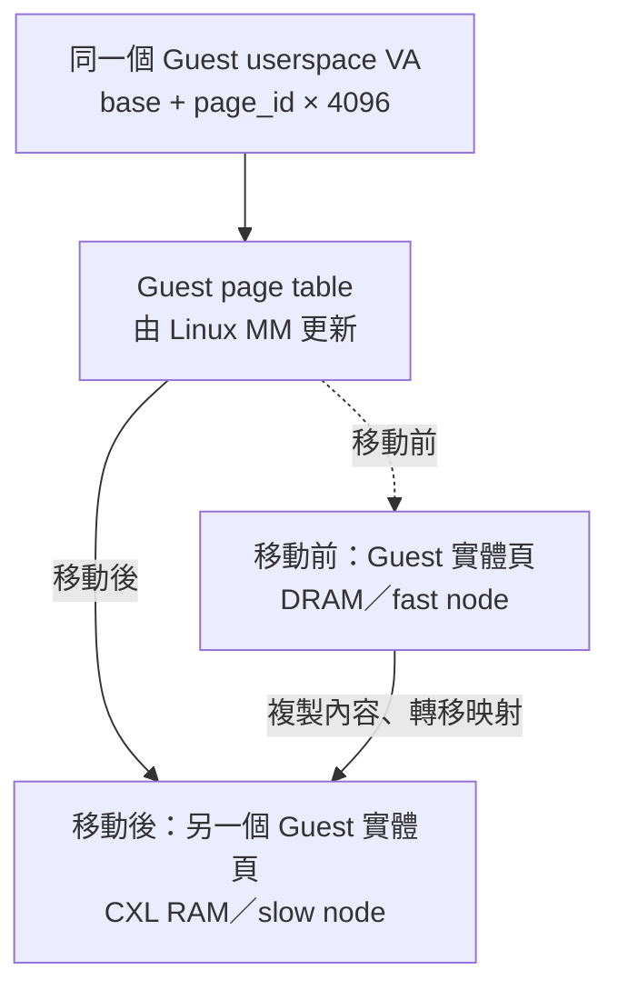

### 1.2 QEMU 中有哪些位址與容量

| 名稱 | 此專案的意義 | 常見混淆 |
|---|---|---|
| Guest VA | `tierlab` 的程序虛擬位址，`move_pages` 以此查詢／移頁 | 不是 CXL 裝置的 DPA |
| Guest physical address | Guest Linux 看到的實體位址；CXL region 佔其中一段 | 不是 Windows／WSL 的實體位址 |
| HPA／DPA | CXL 解碼鏈的 host／device physical address；此處的 host 指 CXL 所屬的 Guest 平台 | 不應把 HPA 的 host 誤讀成執行 QEMU 的 WSL Host |
| 3 GiB DRAM backend | Guest 初始一般 RAM，有明確 NUMA backend | 不包括 CXL 的 1 GiB |
| 1 GiB CXL backend | Type-3 裝置可提供的 volatile capacity | 不是持久化 PMEM |
| 4 GiB CFMWS | CXL Fixed Memory Window 的位址路由視窗 | 不是另外增加 4 GiB 已配置 RAM |
| 3 GiB rootfs image | Guest 磁碟檔案系統容量 | 和 Guest DRAM 3 GiB 沒有容量共用關係 |

QEMU 的 CXL 模型提供 host bridge、root port、Type-3、decoder 與位址視窗，讓 Guest 走裝置發現與記憶體配置路徑；此模型的用途與限制可參照 [QEMU CXL 文件](https://www.qemu.org/docs/master/system/devices/cxl.html)。本專案的命令與原始碼仍以釘版 11.1.0 為準。

### 1.3 裝置存在，為什麼還不能拿來配置匿名頁

`cxl list` 看見 memdev，只證明裝置被發現。還需要建立 RAM region、經過 DAX/kmem 把 range 交給一般記憶體管理，並讓對應 blocks 上線。

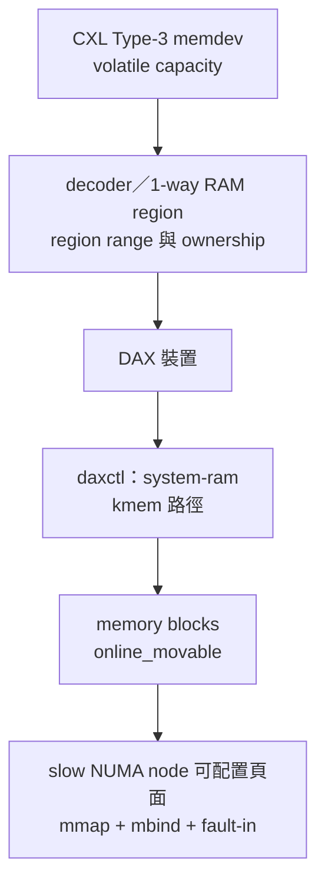

`ZONE_MOVABLE` 是頁面配置區域；NUMA node 是拓樸管理單位；memory block 是上／下線管理單位，三者不是同一種物件。本次 CXL range 為 1 GiB，拆成 8 個 128 MiB blocks。標準 M2 managed mapping 只有 128 MiB，因此「受管理頁面全部移走」並不能單獨證明整個 1 GiB range 可下線。

`online_movable` 讓這段記憶體以可移動配置為主，降低不可移動配置妨礙下線的機會；它不保證任何時刻 offline 都成功。Guest helper 必須實際寫入 block state 並讀回確認。

### 1.4 本專案刻意固定的條件

只處理 4 KiB private anonymous pages、單執行緒 workload、單一 volatile Type-3 與 1-way region。關閉實驗中的 THP、automatic NUMA balancing、KSM、swap 與自動 demotion 干擾，才能把 query 的變化連回本專案送出的移頁要求。這是控制變因，不代表這些核心功能在一般系統中沒有用途。

`CONFIG_TRANSPARENT_HUGEPAGE=y` 是編譯能力與相依條件；cmdline 的 `transparent_hugepage=never` 和 mapping 的 `MADV_NOHUGEPAGE` 是實驗執行時的限制。兩者位於不同層，不能為了停用執行時 THP 而直接刪掉 DAX 所需的 build dependency。

<details>
<summary>自問：移頁後，原本的 C++ 指標需要換掉嗎？</summary>

不需要。程序使用的 VA 不變，核心處理實體頁與映射變更。要另外用 query 確認目標 node，用完整 pattern scan 確認內容仍正確；「指標沒有變」無法證明頁真的移動過。

</details>

<a id="build"></a>

## 2. 從乾淨 Host 建置

這一章把建置分成 Host 條件、來源與編譯、Guest 映像、實際執行四個階段。每階段都有可檢查的產物：遇到失敗時，先找出最後成功的階段，再讀下一個階段的第一筆錯誤。編譯完成、KVM 可用與 Guest 驗證通過，各自代表不同事情。


### 2.1 確認執行位置、資源與權限

以下 Linux 命令都在 Ubuntu 26.04 的專案根目錄執行，範例假設 checkout 位於 `~/src/cxl-fw`，請依實際位置調整。Windows 可用檔案總管開啟專案，但編譯、套件安裝及 VM runner 都交給 WSL 的工具。從 PowerShell 進入 WSL，再進入工作目錄：

```text
wsl.exe -d Ubuntu-26.04

# The following commands run inside Ubuntu.
cd ~/src/cxl-fw
pwd
cat /etc/os-release
uname -m
id
df -h .
free -h
```

預期工作目錄在 Linux 檔案系統，作業系統為 Ubuntu 26.04，架構為 `x86_64`，目前帳號不是 root。Guest 同樣使用 amd64 使用者空間；本專案沒有跨架構交叉編譯流程。

| 檢查項目 | 專案條件 | 怎麼解讀 |
| --- | --- | --- |
| 磁碟空間 | doctor 要求至少 35 GiB 可用 | 來源樹、kernel object、映像、overlay 與原始紀錄都會占空間；後續保留多次 run 仍需自行觀察成長量。 |
| Host 記憶體 | doctor 要求 MemAvailable 至少 2048 MiB | 這是 Host 預檢門檻，不能當作完整實驗需求。單一 Guest 配置 3 GiB DRAM 加 1 GiB CXL，Host 與 QEMU 還有額外消耗。 |
| 編譯並行 | `BUILD_JOBS=2`；builder 只接受 1–4 | 目前按 8 GiB WSL 預算限制並行。增加 jobs 不會增加實驗深度，可能先造成 Host 記憶體壓力。 |
| KVM | 一般使用者能開啟 `/dev/kvm`、取得 API 12 並建立空 VM | 硬體加速的最低可用證據；尚未執行任何 Guest kernel。 |
| 一般使用者 | 來源 builder、doctor、runner | 能證明平常使用者具備權限，也避免編譯產物不必要地由 root 擁有。 |
| sudo | 安裝缺少的 Host 套件、增加 kvm 群組、建立 rootfs | rootfs 需要 chroot、安裝 modules 與建立系統目錄；QEMU 本身不需要 root。 |

依據：[scripts/doctor.py：probe()，第 73–108 行](../scripts/doctor.py)；[scripts/build.py：main()，第 226–229 行](../scripts/build.py)。


### 2.2 安裝相依，確認一般使用者的 KVM 權限

```bash
make setup-host
# If the kvm group was added, start a fresh login process before continuing.
id
ls -l /dev/kvm
make doctor
jq '{host_ready, kvm, guest_boot, resources, errors}' results/host/environment.json
```

`setup-host` 只安裝 [configs/host-packages.txt](../configs/host-packages.txt) 中尚未安裝的項目，然後把目前帳號加入既有的 `kvm` 群組。它不執行系統升級、不修改 `.wslconfig`，也不把裝置權限改成任何人可寫。群組是程序建立時取得的憑證；帳號資料更新後，舊 shell 仍可能沒有新群組，需要新的登入程序。

doctor 的正常終端輸出包含 `Host environment: READY; KVM=PASS; Guest boot=NOT_RUN`。同時保留 `results/host/environment.json`，其中記錄實際工具版本、套件版本、資源與 KVM probe。看到 `NOT_RUN` 是這一步的正確結果，因為它沒有啟動 Guest。

> **補充**
>
> 若 KVM 失敗，先依報告中的 errno 分流：`EACCES` 對應帳號、群組或裝置存取；裝置不存在或 API 不符，則先檢查 Host 虛擬化條件。不要用 root 重跑 doctor 來掩蓋一般使用者權限問題；doctor 會拒絕這種驗證。

| 工具組 | 在專案中的責任 | 不應混淆的概念 |
| --- | --- | --- |
| GCC/G++、libnuma、nlohmann-json | 編譯 C++17 程式，連結 NUMA 使用者空間介面並輸出結構化紀錄 | libnuma 是介面函式庫；實際頁面位置由 Guest kernel 管理。 |
| CMake、Ninja、CTest | 產生編譯規則、增量編譯、執行 Host 契約測試 | CTest 通過不等於真實 move_pages 或 CXL 操作通過。 |
| Meson、Ninja、QEMU configure | 建置指定 x86_64 system emulator | 專案的 QEMU 與 apt 提供的 qemu-img 用途不同。 |
| debootstrap、chroot、mkfs.ext4 | 產生 Ubuntu 使用者空間、安裝 Guest 套件、封裝 rootfs | rootfs 是 Guest 的磁碟內容；不是 WSL Host 的根目錄。 |
| cxl、daxctl、ndctl | Guest 探索及配置 CXL/DAX 裝置 | Host 安裝編譯相依，不表示可對 Host 的 memory sysfs 執行實驗。 |
| QMP、serial、9p | 分別處理 VM 控制、console、run 專用檔案交換 | 三條通道可以互相對照，但不能互相取代。 |


### 2.3 先做快速檢查，再建置釘版產物

```bash
make check-quick
make build BUILD_JOBS=2
```

第一個命令檢查文件結構、專案設定、採用檔來源與 Python 測試，不做重型建置。第二個命令依序完成 QEMU、kernel、tierlab、上游 migration selftest、rootfs。最後的 rootfs 步驟會使用 sudo；整條 `make build` 不應加 sudo。

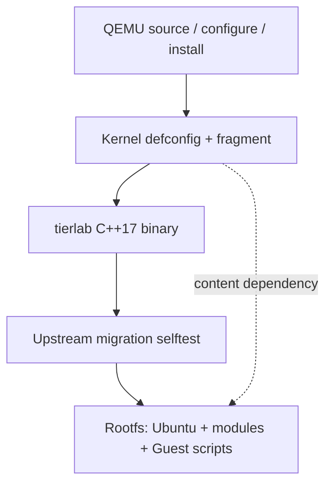

*Makefile 的執行順序。rootfs 的內容依賴 kernel 與 Guest 腳本；tierlab 在每個 run 開始時複製到 share，不封裝在 base image。*

來源版本與 SHA256 位於 [configs/versions.lock.json](../configs/versions.lock.json)：QEMU 11.1.0、Linux 6.18.56。每次下載或重用 archive 都核對 hash；解壓使用 tar data filter，既有來源樹必須有相符的 extraction provenance。最初的 QEMU release 使用 detached signature 核實來源，Linux 對照官方 HTTPS checksum；日常 builder 依鎖定 hash 重新檢查，不自動升版。

| 階段與命令 | 應出現的產物 | 失敗時先查 |
| --- | --- | --- |
| `make qemu BUILD_JOBS=2` | `install/qemu/bin/qemu-system-x86_64`、`build/qemu/build-meta.json` | `build/logs/qemu-*.log` 的第一個 configure/compile error；區分缺套件、來源 hash 與編譯失敗。 |
| `make kernel BUILD_JOBS=2` | `build/kernel/arch/x86/boot/bzImage`、`vmlinux`、`.config`、`config-audit.json`、`build-meta.json` | config audit 或 `build/logs/linux-*.log`；fragment 的要求是否被 Kconfig 相依消除。 |
| `make tierlab` | `build/tierlab/tierlab` 與四個契約測試 binary | CMake 的相依探索、編譯器錯誤、link error。使用本專案 CMake 配置，不手寫遺漏函式庫的編譯命令。 |
| `make upstream-selftest` | `build/selftests/mm/migration` 與 `build-meta.json` | 對應 Linux build log；這是釘版上游測試，與專案 tierlab 分開保存來源與 binary hash。 |
| `make rootfs` | `images/rootfs.ext4`、`rootfs.meta.json`、`rootfs.packages.tsv` | `build/logs/rootfs.log`；先分辨 apt/debootstrap、modules_install、映像製作或 provenance 不一致。 |

kernel 建置以 `x86_64_defconfig` 為底，再合併 fragment、執行 `olddefconfig`，最後稽核實際 `.config`。以下為 `build_kernel()` 的原始片段：

```python
run(["make", "-C", source, f"O={out}", "x86_64_defconfig"], ROOT, log, timeout=180)
run(["bash", source / "scripts/kconfig/merge_config.sh", "-m", "-O", out,
     config, fragment], source, log, timeout=180)
run(["make", "-C", source, f"O={out}", "olddefconfig"], ROOT, log, timeout=180)
audit = verify(config, fragment, source)
write_metadata(out / "config-audit.json", audit)
```

原始碼：[scripts/build.py：build_kernel()，第 175–180 行](../scripts/build.py)。`O=` 把編譯產物與來源樹分開；稽核是在 Kconfig 完成相依解析之後執行。


### 2.4 讀懂 kernel 設定與 boot cmdline

設定檔回答「這份 kernel 有沒有編進能力」，cmdline 回答「這次啟動使用什麼行為」。兩者需要一起讀。例如 DEV_DAX 的建置需要 THP 能力，但本實驗在執行期間關閉 THP，以維持 4 KiB 頁面分母。

| 能力／設定 | 用途 | 本專案的選擇 |
| --- | --- | --- |
| `CONFIG_NUMA`、`CONFIG_MIGRATION` | NUMA node 與頁面移動 | 編入；move_pages 對實際 node 操作。 |
| `MEMORY_HOTPLUG`、`MEMORY_HOTREMOVE` | 將 CXL 範圍加入一般記憶體，再 offline | 編入；`memhp_default_state=offline` 讓 helper 明確決定哪些 blocks 上線。 |
| `DEV_DAX_CXL`、`DEV_DAX_KMEM` | CXL region 連接 DAX、再轉成 system RAM | 編入，搭配 Guest 的 cxl/daxctl。 |
| `CONFIG_ZONE_DEVICE=y` | devdax 使用的 page map | 必須保留；移頁與 offline 成功，也不能證明 devdax probe 一定可用。 |
| `TRANSPARENT_HUGEPAGE=y` | 滿足 DEV_DAX 的建置相依 | 執行期 `transparent_hugepage=never`，mapping 另檢查實際頁面配置。 |
| `numa_balancing=disable` | 避免自動 NUMA balancing 干擾 controlled placement | Guest 可用時再明確關閉；另外停用 KSM 與自動 demotion。 |
| `CONFIG_CXL_REGION_INVALIDATION_TEST=y` | 允許 Hypervisor 下建立測試用 region | QEMU 專用測試 kernel 設定；不提供實體 CXL cache 一致性證據。 |
| `FTRACE`、`TRACEPOINTS`、`EVENT_TRACING` | 使用既有 migration tracepoints | 編入；M4 另確認當前事件格式、PID、loss counters。 |

```bash
cat configs/cmdline.txt
jq . build/kernel/config-audit.json
install/qemu/bin/qemu-system-x86_64 --version
file build/tierlab/tierlab
jq '{kernel_release, image_sha256, kernel_config_sha256, guest_inputs}' images/rootfs.meta.json
```

預期 QEMU 版本為 11.1.0，rootfs metadata 的 kernel release 為 6.18.56。Host 的 `uname -r` 仍顯示 WSL kernel；只有進入指定 Guest，才會看到專案自編 kernel。

設定：[configs/kernel.fragment](../configs/kernel.fragment)、[configs/cmdline.txt](../configs/cmdline.txt)；執行期處理：[guest/run.sh：第 77–80 行](../guest/run.sh)。


### 2.5 驗證順序與第一次產物閱讀

```bash
make tierlab-test
make tierlab-sanitize
make check
make demo

jq '{status, checks: [.checks[] | {name, status}]}' .paef/reports/latest-full.json
jq '{status, accel, gates, runs: [.runs[] | {run_id, status, boot_id}]}' results/gates/G0.json
```

`make check` 已包含 C++ 契約及 sanitizer；前兩個命令適合第一次逐層確認或局部修改後重跑，並非完整檢查前必須重複執行的額外要求。完整檢查會依序跑 Host 檢查、C++ 契約、ASan/UBSan，以及 G0–G5 真實 Guest。最後檢查 gate 是否通過，並核對 `accel`。目前預設 `auto` 會在 KVM 無法使用時退回 TCG；TCG 的完成紀錄不能描述為 KVM 結果。

需要明確要求 KVM 時，可對單一 scenario 使用 runner 參數；這個模式在 KVM probe 失敗時停止，不退回 TCG：

```bash
python3 scripts/run.py boot --repeat 3 --accel kvm
python3 scripts/run.py migrate --repeat 1 --accel kvm
python3 scripts/run.py policy --repeat 1 --accel kvm
python3 scripts/run.py offline --repeat 1 --accel kvm
python3 scripts/run.py trace --repeat 1 --accel kvm
```

單獨執行這些命令前，先完成建置。平常可使用 `make boot-test`、`make migrate-test`、`make policy-test`、`make offline-test`、`make trace-test`；其中 tierlab 與 upstream baseline 的必要局部建置由 Makefile 處理，Guest 腳本改動仍需重建 rootfs。

| 結果檔 | 驗證責任 | 往下追的原始紀錄 |
| --- | --- | --- |
| `results/gates/G0.json` | 至少三次獨立 boot/shutdown，boot IDs 不同 | 每個 run 的 console、QMP、guest.json、dmesg |
| `results/gates/M1.json` | G1 拓樸／CXL 上線，G2 真實雙向移頁與負例 | topology、sysfs、逐頁 syscall/query 紀錄 |
| `results/gates/M2.json` | G3 B0/B1/B2、三 seeds、固定分母與 phase shift | `shared/policy.jsonl`、`policy_verified.json` |
| `results/gates/M3.json` | G4 drain、逐 block offline、DAX/region teardown | `shared/drain.jsonl`、`offline.jsonl`、CLI/readback |
| `results/gates/M4.json` | G5 syscall/trace/query、上游 baseline、trace loss | trace.log、trace_batches.jsonl、collector.json、TAP |

先用 `make demo` 閱讀保存的結果。它重新跑 Host evaluator，核對目前 binary/image/config hashes，再顯示各層證據。它沒有建立 VM，也沒有重新執行 kernel 實驗。若來源、binary 或映像已更新，舊 gate 會被拒絕，需重新產生對應結果。


### 2.6 修改後該重建什麼

| 修改範圍 | 最小有意義的後續動作 | 原因 |
| --- | --- | --- |
| 教學、設定說明、Host scaffold | `make check-quick`，檢查文件連結與敘述 | 不需要為純教學改動重跑所有 Guest；文件應區分目前執行與既有結果。 |
| C++ policy/migrator/drain | `make tierlab-test`、必要的 sanitizer、對應 Guest scenario | Host fake 先確認分支契約，Guest 再確認真實系統行為。 |
| `guest/*.sh`、`guest/*.py`、service | `make rootfs`，再跑對應 scenario | Guest 使用映像內的 helper。run.py 會拒絕與目前來源不符的映像。 |
| kernel.fragment／kernel | `make kernel` → `make rootfs` → Guest 驗證 | bzImage、modules 與 config provenance 必須配套。 |
| 宣告整體目前可用 | `make check` | 局部成功不能代替完整跨層回歸。 |

> **注意**
>
> 遇到既有 `rootfs.ext4.tmp`、不完整 rootfs tree 或 hash 不符時，builder 會保留現場並停止。先讀 log 與 manifest，確認上一個失敗原因；不要以刪除整個 build tree、放寬驗證或移除 lock file 當作第一個解法。鎖檔是否存在與是否正被持有是兩回事。

<details>
<summary>自問：為何 make check-quick、make doctor 與 make check 都有必要？</summary>

三者測試的層次不同。check-quick 檢查專案契約及快速測試；doctor 檢查 Host 可執行條件；check 進一步驗證真正的 Guest kernel、CXL、移頁、policy、offline 與 trace。前一層成功，只能降低後一層失敗的可能性，不能代替後一層證據。

</details>

<a id="architecture"></a>

## 3. Host／Guest 的執行架構

整個實驗只有一個專案 Guest binary `tierlab` 與一個 Host runner `scripts/run.py`。Host 負責建立可對照的 run、控制 VM 與獨立驗證；Guest 負責配置指定 CXL 範圍並執行記憶體操作。policy 只決定候選頁，kernel query 決定實際位置。


### 3.1 從 Make target 追到 Guest 函式

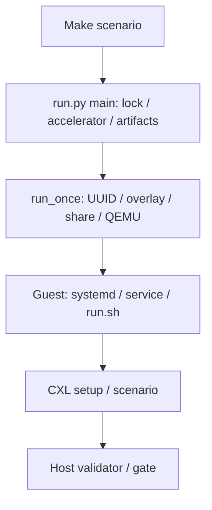

*一次 scenario 的主要控制流。Guest 自動完成、保存結果並正常關機，Host 等待 QEMU 結束後重算證據。*

1. `main()` 取得 `build/heavy.lock`，選擇 accelerator，呼叫 `load_artifacts()`。這時還沒有 VM；缺產物或 provenance 不符會在開機前停止。
2. `run_once()` 產生 run UUID，建立專用 share/config、固定 base inode、建立 overlay，複製 binary 並保存完整 QEMU argv 與 hashes。
3. Guest 使用標準 `/sbin/init`。systemd 啟動 `tierlab.service`，由 `tierlab-run` 先檢查釘版 kernel、root 與 QEMU identity，通過才註冊關機清理。
4. Guest 掛載該 run 的 9p share、讀取 run_id/scenario、核對工具。非 boot scenario 先停用受控實驗不需要的自動搬移，再執行 `cxl_setup.py` 取得實際 fast/slow node。
5. 一般情況執行 `tierlab SCENARIO ...`；trace 由 `trace.py` 包裝；offline 在 C++ drain 成功後，才執行 `cxl_offline.py`。
6. Guest 保存 dmesg、guest.json，印出含相同 run_id 的 `TIERLAB_DONE` marker，然後要求正常 poweroff。
7. Host 確認 QEMU exit code、Guest identity/status、console 與 dmesg 健康，再呼叫 scenario 專屬 evaluator。通過後才產生相應 gate。

讀碼入口：[Makefile](../Makefile) → [scripts/run.py：main() / load_artifacts() / run_once()](../scripts/run.py) → [guest/tierlab.service](../guest/tierlab.service) → [guest/run.sh](../guest/run.sh) → [src/main.cpp](../src/main.cpp)。


### 3.2 三條通道各自回答什麼

| 通道 | 方向及內容 | 能證明／不能證明 |
| --- | --- | --- |
| QMP Unix socket | Host ↔ QEMU：握手、query-status、powerdown、quit、非同步事件 | 回答 VM 控制狀態。不能證明 Guest payload 或每頁位置正確。 |
| serial console | Guest → Host：boot messages、service output、correlated completion marker | 回答開機與錯誤時間線；需與 guest.json/dmesg/raw data 對照，單一 PASS 字串不足。 |
| 9p share | Host → Guest：config/binary；Guest → Host：JSONL、sysfs snapshots、trace、TAP | 傳遞可重算原始紀錄。Host 檢查 schema、run_id、hash 與數值契約，不能直接相信檔名或狀態欄。 |

QMP 是帶 request ID 的 JSON 協定，也會收到沒有對應當前命令的非同步事件。`QMP.command()` 會保存 events 與其他 response ID，直到找到目前命令的回應；不能假設每次讀取的第一筆 JSON 就是剛送出的回覆。QMP socket 路徑受 Unix socket 長度限制，runner 在第 212 行先檢查，過長時應縮短 Linux workspace 路徑。


### 3.3 磁碟、共享目錄與執行檔的生命週期

```text
images/rootfs.ext4                  # Verified, read-only base image
results/runs/<run_id>/
  base.ext4                         # Hard link to the exact base inode
  rootfs-overlay.qcow2              # This run's writable Guest disk
  config.json / meta.json            # Scenario, argv, accelerator, input hashes
  console.log / qemu.stderr.log      # Boot output and emulator diagnostics
  qmp.jsonl / summary.json           # VM control transcript and final result
  shared/
    config.json / tierlab            # Inputs copied for this run
    guest.json / dmesg.log           # Correlated Guest result and health log
    topology.json / ...              # Raw scenario evidence
```

每個 run 先 hardlink 唯讀 base image，再以該路徑建立 qcow2 backing。即使稍後重新建立 `images/rootfs.ext4`，舊 run 的 backing 仍指向原 inode。qcow2 只保存該次 Guest 的寫入差異；base image 不會被 Guest 改寫。單靠一個會被重新命名替換的 backing path，無法提供同樣保證。

```python
os.link(artifacts["base"], pinned_base)
if scenario in {"migrate", "policy", "offline", "trace"}:
    shutil.copy2(artifacts["tierlab"], shared / "tierlab")
    if sha256(shared / "tierlab") != artifacts["hashes"]["build/tierlab/tierlab"]:
        raise ValueError("Copied Guest binary differs from input provenance")
```

原始碼：[scripts/run.py：run_once()，第 254–258 行](../scripts/run.py)。binary 經過 hash 核對後，Guest 執行這份副本；另存 readelf 結果，協助判斷 architecture、loader 與動態函式庫問題。

Guest scripts 與 tierlab 採不同更新方式：helper 安裝在 rootfs，更新後需重新封裝；tierlab 在每次 run 複製，重新編譯後不必為它單獨重建 rootfs。兩條路徑最後都由 input hashes 連到該次 gate。


### 3.4 QEMU 拓樸與 Guest 可觀測的配置

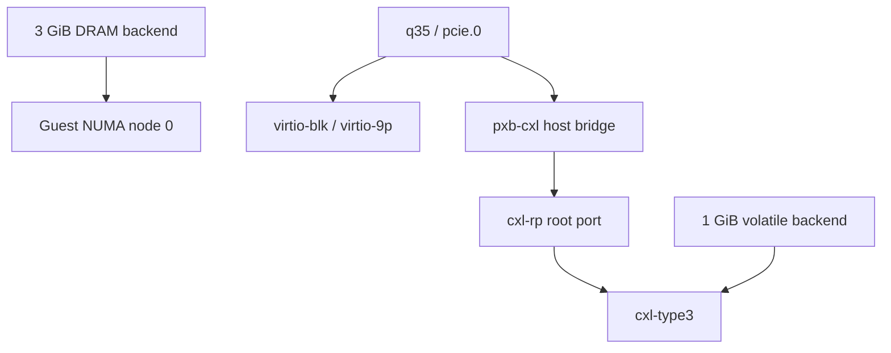

*虛擬裝置連接。DRAM 另外由明確 3 GiB NUMA backend 建立；Guest 讀實際 sysfs/ACPI 結果，不將這張圖的預期當成成功證據。*

Host argv 指定 `memory-backend-ram,id=dram0,size=3G`，再連到 NUMA node 0，讓 Guest 能取得一致的 DRAM NUMA 描述。CXL 則由另一個 1 GiB backend 供給 Type-3 裝置，CFMWS window 為 4 GiB。window 是允許 CXL 位址配置的範圍，不是額外增加 4 GiB 記憶體。virtio 裝置明確連接 `pcie.0`，避免預設 bus 選擇受新增 CXL bridge 影響。

Guest 的 `cxl_setup.py` 仍需探索 memdev、decoder、region、DAX device、physical range、node 與 memory block。之後用 iomem/sysfs 核對所有權，再將確定屬於指定 CXL range 的 blocks 上線。node number、region 名稱與 block 編號是觀測結果，不能以某一次 run 的 `node1` 或 `memory42` 取代探索。


### 3.5 決策、執行與評估分開

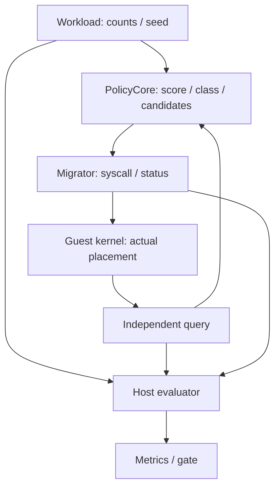

*資料流。query 也回饋給下一次 policy 規劃；評估端重新讀取原始 query 與 workload 紀錄，不把 policy 的意圖當成實際 residency。*

這個分界讓局部測試有意義。FakeMigrator 能刻意回傳 partial failure、untouched status、EBUSY 等結果，檢查 policy/drain 是否做出正確反應；真實 Guest 則檢查同一套契約與 kernel 是否相容。MockSysfs 測 rollback 分支，真實 Guest 驗證實際 whitelist 與 teardown。兩種結果都要保留，但不可互相冒充。

> **補充**
>
> 本專案的 `fast`/`slow` 是實驗角色名稱。QEMU 使用 RAM backend 提供兩側容量，placement 指標可驗證頁面是否放對；沒有校準過的實體 CXL 延遲與頻寬，不能從 HFR/AWFR 推導應用效能提升。


### 3.6 為什麼結果需要多層交叉核對

一次 `move_pages` 的返回碼只描述該呼叫結果，tracepoint 描述核心走過的事件，而 query 描述查詢當下的 residency。它們的範圍不同。資料完整性掃描又回答另一個問題：搬移後頁面內容是否仍符合寫入模式。完整結果必須同時滿足各自契約。

| 證據 | 回答的問題 | 不能單獨推出 |
| --- | --- | --- |
| syscall rc/errno/status | 這次請求如何返回？哪些 per-page status 有效？ | 之後沒有其他因素改變位置。 |
| 獨立 kernel query | 每一頁在該觀測點位於哪個 node？有無無效/缺值？ | 哪一條 migration 事件對應哪個 VA。 |
| trace marker + migration events | 指定 PID/batch 時間窗內，核心發出哪些移頁事件？ | aggregate 成功數不能取代逐頁位置。 |
| 完整 payload scan | 已配置記憶體的內容是否符合預期？ | 資料正確不代表位於要求的 node。 |
| console/dmesg/QMP | VM 是否健康，結果是否來自相同 run，是否正常結束？ | 正常關機不代表 scenario 邏輯正確。 |
| input hashes / manifests | 這份結果對應哪個 binary、image 與設定？ | hash 相同只保證內容相同，不能單獨證明內容正確。 |

<details>
<summary>自問：如果 tierlab 印出 PASS，但 Host validator 拒絕，應該相信誰？</summary>

先保留兩邊原始資料，找出具體不一致。Guest PASS 只是執行端聲明；Host 按固定契約從原始 query、syscall、trace 與 topology 重算。可能是 Guest 漏掉失敗、缺少紀錄、schema 不符，也可能是 evaluator 錯誤。不能直接改掉門檻；用最小反例確認哪一層的契約被違反，再修正該層。

</details>

<details>
<summary>自問：QEMU exit 0 為何不是整個實驗的成功條件？</summary>

它只說明 emulator 正常退出。Guest 可能因 scenario 失敗而主動 poweroff；也可能缺少有效結果。runner 仍要求相同 run_id 的 completion marker、guest.json、健康 dmesg 與獨立 evaluator 通過。

</details>

<a id="migration"></a>

## 4. M1：配置、移頁與資料完整性

### 4.1 先讓匿名頁實際存在

`mmap` 建立的是虛擬區間，不表示每個匿名頁都已配置。`Mapping` 先設定目標 node，再以 `write_pattern` 寫過整段，讓各頁 fault-in；隨後 query 才有實際頁面可查。

```text
Mapping(bytes, node)                     src/guest_runtime.cpp
  mmap(MAP_PRIVATE | MAP_ANONYMOUS)      建立 VA 區間
  madvise(MADV_NOHUGEPAGE)               限制這個 mapping 不使用 THP
  mbind(MPOL_BIND, nodemask, ..., 0)     設定後續配置的 node policy
write_pattern(data, generation, bytes)   寫過所有 8-byte words，觸發配置
require_no_huge_pages(data, bytes)       從 smaps 核對 AnonHugePages
LinuxMigrator.query(all_page_ids)        查每個頁面的實際 node
```

來源：[Mapping 與 pattern](../src/guest_runtime.cpp)、[M1 主流程](../src/main.cpp)。`mbind` 的 flags 為 0；這裡不能把它解釋成「將既有頁面搬到目標 node」。本版真正的移動由稍後的 `move_pages` 負責。

Node mask 以 `unsigned long` 向量配置；node 64 需要第二個 word。在釘版核心的 `get_nodes`／libnuma ABI 下，`maxnode` 使用 `mask.size() * bits + 1`。這是有範圍與 ABI 前提的實作，不能直接簡化成 `maxnode = 2`；[mapping tests](../tests/cpp/mapping_tests.cpp) 覆蓋 0、1、63、64、4095 的邊界。

### 4.2 page_id 如何對應到 syscall 的 VA

```cpp
void* LinuxMigrator::address(std::uint64_t id) const {
    if (id >= bytes_ / page_size_)
        throw std::out_of_range("page_id outside managed mapping");
    return reinterpret_cast<void*>(base_ + static_cast<std::uintptr_t>(id) * page_size_);
}
```

以上摘自 [src/migrator.cpp 的 `address`](../src/migrator.cpp)，僅將長行換行。建構子還檢查 base 對齊、bytes 為 4096 的正整數倍、位址加總不溢位。`page_id` 是專案管理索引，核心收到的仍是 `pages[]` 內的 VA。

假設 `base = 0x70000000`，`page_id = 3`，則送出的 VA 是 `0x70003000`。若 mapping 只有 64 頁，id 64 已超出範圍。M4 的非法 VA 負例刻意走直接 syscall 路徑；不能為了製造負例而放寬一般 `LinuxMigrator` 的範圍檢查。

### 4.3 一個 adapter，兩種 syscall 用法

```cpp
errno = 0;
const long rc = ::syscall(SYS_move_pages, 0, count, pages, nodes, status, flags);
return {rc, rc == -1 ? errno : 0};
```

來源：[src/migrator.cpp 的 `linux_move_pages`](../src/migrator.cpp)。`pid=0` 指操作目前程序；沒有操作 Host 上其他程序。`errno` 在呼叫後立刻保存，避免後續 query／I/O 覆蓋它。

| 呼叫 | `nodes` | `flags` | 要回答的問題 |
|---|---|---|---|
| query | `nullptr` | `0` | 這些 VA 目前各在哪個 node？ |
| move | 每頁一個 target node | `MPOL_MF_MOVE` | 請把這些頁移到指定 node |

`move_pages` 有整批結果和逐頁結果；這兩層不能互相代替。介面定義見 [move_pages(2)](https://man7.org/linux/man-pages/man2/move_pages.2.html)，精確分支行為則要核對本專案的 Linux 6.18.56。

| 欄位 | 正確解讀 | 錯誤解讀 |
|---|---|---|
| `rc == -1`、`errno > 0` | userspace syscall wrapper 的整批錯誤；保存 errno | 把 status 中看似正常的值照算成功 |
| `rc > 0` | 有未完成移動的情況，需逐項讀證據 | 當成成功頁數，或當整批成功 |
| `rc == 0` | 仍需檢查每頁 status 和後續 query | 保證所有輸入 VA 都有效 |
| 有效 `status[i] >= 0` | 回報該頁的 node ID | 0 表示布林 false／失敗 |
| 有效 `status[i] < 0` | 逐頁錯誤，例如 `-EFAULT` | 和正值 syscall errno 混為同一欄 |
| `status[i] == INT_MIN` | 程式預先放的未知 sentinel；該 entry 未被可靠填寫 | 當成 node，或從分母略掉 |

本專案只在 `rc >= 0 && status[i] != unknown_status` 時標記 `move_status_valid=true`。整批失敗仍保留 raw status 供診斷，但不把它當有效移頁回報。

### 4.4 為什麼移動前後都要 query

```cpp
const auto before = query(ids);
std::vector<int> targets(ids.size(), target), status(ids.size(), unknown_status);
const auto call = invoke_(pages.size(), pages.data(), targets.data(),
                          status.data(), MPOL_MF_MOVE);
const auto after = query(ids);
```

來源：[src/migrator.cpp 的 `move`](../src/migrator.cpp)。原始碼接著把 before、syscall status、validity、after 都存入 `BatchResult`。

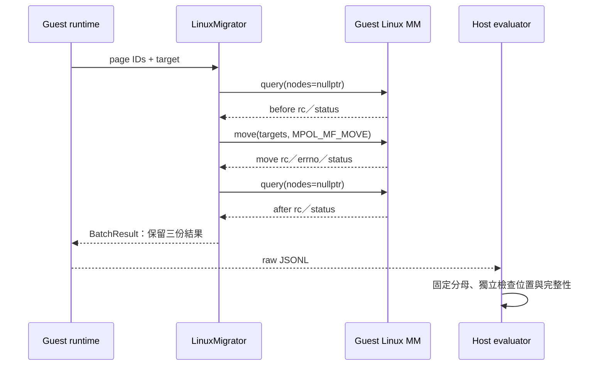

判斷「真的移動」時，要有有效的 before／after query，且 `before != target && after == target`。若 before 本來就在 target，只能算已在目標，不能膨脹成一次成功搬移。若整批 syscall 出錯，但 query 證明其中一頁已改變位置，仍據實保存觀察；不能改寫原本的 rc／errno。

固定分母也很重要：要求 256 頁，只查到 255 個有效結果，不能報 255/255。缺值本身就是驗收失敗；M1、M2、M3 的 validator 都有明確的頁數與 query 完整性要求。

### 4.5 M1 的完整往返

```bash
# WSL Host，一般使用者；已完成 make build
make migrate-test
python3 -m json.tool results/gates/M1.json
```

本實驗使用 64 MiB，即 16384 個 4 KiB 頁。流程為：DRAM 配置並寫 pattern → query 全在 fast → 分批移到 slow → query／全量掃描 → 在 slow 重寫下一代 pattern → 移回 fast → query／全量掃描。每批最多 256 頁，兩方向都要核對全部 16384 頁。

Pattern 以 page、word offset、generation 生成每個 64-bit word 的預期值。只看第一頁或只看摘要 checksum，會漏掉未觸及區域；本版逐 word 比對。Generation 改變則可區分「移過去仍可讀到舊內容」與「在 slow 確實能寫入新內容再移回來」。

Gate 存在 `results/gates/M1.json`；從其中 `runs` 找到該次 `results/runs/<run_id>/`。`shared/migration.jsonl` 保存原始批次，`migration_verified.json` 是 Host 重算結果，另有 topology、iomem、DAX／CXL CLI 與 sysfs 快照。這些為本機產物，新的 Git checkout 需先執行命令才會產生。

<details>
<summary>自問：為什麼不能把 status 初始化成 0？</summary>

0 是合法的 node ID。若核心未填某個 entry，預設 0 會冒充 node 0 的成功結果。`INT_MIN` 能保留未知；即使 rc 非負，尚未覆寫的 sentinel 也不能視為有效狀態。

</details>

<a id="trace-code"></a>

## 5. 沿著一次移頁追原始碼

追程式碼先確定要回答的問題。本節只追「把同一個程序的一批匿名頁移到另一個 NUMA node，回傳結果如何形成」。先從呼叫點建立輸入、狀態與分支，再進入核心；每遇到一層都記下這層新增的限制與輸出。這樣才能解釋成功、部分失敗和提早返回，並決定接下來需要哪種執行證據。

### 5.1 先固定版本與要追的案例

原始碼以本專案下載的 Linux `6.18.56` 為準。一般文件用來理解介面，本機釘版原始碼用來核對這次實作。以下讀取指令在 **Host 的專案根目錄**執行，只讀檔案，不操作頁面位置：

```bash
cd ~/src/cxl-fw
grep -n 'SYS_move_pages' src/migrator.cpp
grep -n 'kernel_move_pages\|do_pages_move\|do_pages_stat' \
  build/sources/linux-6.18.56/mm/migrate.c
sed -n '2580,2616p' build/sources/linux-6.18.56/mm/migrate.c
sed -n '2340,2434p' build/sources/linux-6.18.56/mm/migrate.c
```

`grep -n` 先找符號及行號，`sed` 再讀一個完整函式的相關分支。檔案尚未下載時，先完成建置章節的來源下載步驟。不要直接套用另一版核心的行號。

| 追蹤欄位 | 本節固定的內容 | 閱讀時必須回答 |
| --- | --- | --- |
| 觸發點 | `run_trace()` 的 `roundtrip_out` | 哪個呼叫會真正進入核心？ |
| 輸入 | 64 個對齊 VA、同一 target node、`MPOL_MF_MOVE` | VA 是哪個程序的？映射是否仍存在？ |
| 初始狀態 | 64 頁都經 query 確認位於 fast node | 這是讀核心得到，還是軟體自行推測？ |
| 成功條件 | 移頁狀態有效、after query 全為 slow node、完整 payload 無錯誤 | 系統呼叫成功和資料正確是否分別檢查？ |
| 異常分支 | 非法 VA、非法 target、未改寫的 sentinel | 錯誤在整個呼叫還是個別 entry？ |
| 觀測點 | 原始 rc/errno/status、query、marker、migration events | 每份證據能支持多大的結論？ |

### 5.2 從使用者程式跨到系統呼叫

[`src/migrator.cpp`](../src/migrator.cpp) 第 10–15 行集中處理系統呼叫。第一個參數 `pid=0` 指目前程序；`pages` 裡的位址因此屬於正在執行的 `tierlab`，不是 Host 的虛擬位址，也不是 Guest physical address：

```cpp
SyscallReturn linux_move_pages(unsigned long count, void* const* pages,
                               const int* nodes, int* status, int flags) {
    errno = 0;
    const long rc = ::syscall(SYS_move_pages, 0, count, pages, nodes, status, flags);
    return {rc, rc == -1 ? errno : 0};
}
```

`errno` 必須在失敗發生後立刻保存。這裡的 `syscall()` 是 libc wrapper：核心的負錯誤碼經 wrapper 轉成使用者看到的 `rc=-1` 與正值 `errno`。成功時本專案明確保存 `errno=0`，避免沿用較早的錯誤。

同一個 syscall 同時提供 query 與 move 兩種路徑。`LinuxMigrator::query()` 傳入 `nodes=nullptr`，只讀位置；`move()` 傳入目標節點陣列，才會請求移頁。進核心後的分流位置是 `kernel_move_pages()`：

```cpp
if (nodes)
    err = do_pages_move(mm, task_nodes, nr_pages, pages,
                        nodes, status, flags);
else
    err = do_pages_stat(mm, nr_pages, pages, status);
```

來源：[Linux 6.18.56 `mm/migrate.c`](https://git.kernel.org/pub/scm/linux/kernel/git/stable/linux.git/tree/mm/migrate.c?h=v6.18.56#n2580)，`kernel_move_pages()` 第 2580–2608 行；`SYSCALL_DEFINE6(move_pages)` 第 2610 行。

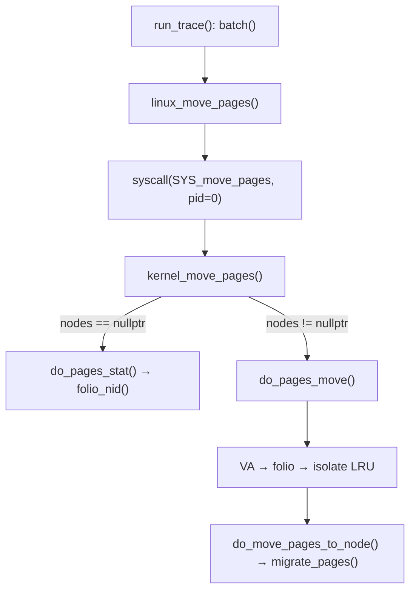

靜態原始碼路徑。這張圖描述控制流程；M4 實際記錄的是 migration tracepoints，沒有替每個內部函式做 function tracing。

### 5.3 核心如何從 VA 找到可以移動的 folio

`do_pages_move()` 逐 entry 讀取 VA 和 target。它先檢查 target 是否在節點編號範圍內、是否有記憶體，以及是否被目前程序的 cpuset 允許；通過才呼叫 `add_folio_for_migration()`。

`add_folio_for_migration()` 持有 `mmap_read_lock`，用 `vma_lookup()` 找出涵蓋 VA 的 VMA，再用 `folio_walk_start()` 沿頁表取得 folio。VMA 描述合法映射範圍；頁表描述當下 VA 對應的實體頁；folio 是核心管理一個或多個連續 base pages 的單位。本實驗固定 4 KiB 頁且排除 THP，不能因此推論所有 folio 都只有一頁。

`__add_folio_for_migration()` 又分三種結果：已在 target 回傳 0；成功從 LRU 隔離並排入 migration list 回傳 1；不能處理則回傳負錯誤碼。這裡 `folio_isolate_lru()` 的「隔離」指從一般 LRU 管理路徑取出，並不表示資料已經複製到另一個節點。

| 原始碼位置 | 讀取重點 | 典型輸出／分支 |
| --- | --- | --- |
| `find_mm_struct()`，2535 行 | `pid=0` 取得 `current->mm` 與允許的 nodes | 確定 VA 所屬的 address space |
| `do_pages_move()`，2373 行附近 | target 範圍、`N_MEMORY`、cpuset | 非法節點可在 migration 前返回 `-ENODEV` |
| `add_folio_for_migration()`，2283 行 | VMA、頁表、folio、migratable | 找不到 VMA 時保留 `-EFAULT` |
| `__add_folio_for_migration()`，2246 行 | zero folio、zone device、現有 node、共享映射、LRU | 已在 target、成功排隊、`-EACCES` 或 `-EBUSY` |
| `move_pages_and_store_status()`，2310 行 | 把累積清單送去移頁，處理回傳並寫 status | 底層移頁失敗時可能提早停止，後續 entries 尚未嘗試 |

### 5.4 真正移頁時，VA 為什麼不需要改？

`do_move_pages_to_node()` 建立 `migration_target_control`，設定目標 nid、`GFP_HIGHUSER_MOVABLE | __GFP_THISNODE` 與原因 `MR_SYSCALL`，接著呼叫 `migrate_pages(..., MIGRATE_SYNC, MR_SYSCALL, ...)`。`__GFP_THISNODE` 限制目的頁配置在指定節點；失敗不代表可以默默在別處配置後宣稱成功。

```text
migrate_pages()
  ├─ trace_mm_migrate_pages_start(mode, reason)
  ├─ migrate_pages_sync()
  │    └─ migrate_pages_batch()
  │         # 第一階段用 MIGRATE_ASYNC；剩餘 folio 逐一以同步模式重試
  │         ├─ migrate_folio_unmap()
  │         │    ├─ alloc_migration_target() → __folio_alloc()
  │         │    └─ try_to_migrate()          # 建立 migration PTE
  │         ├─ try_to_unmap_flush()           # 完成必要 TLB flush
  │         └─ migrate_folios_move()
  │              └─ migrate_folio_move()
  │                   ├─ move_to_new_folio()
  │                   │    └─ migrate_folio() → __migrate_folio()
  │                   │         ├─ folio_mc_copy(dst, src)
  │                   │         └─ __folio_migrate_mapping()
  │                   └─ remove_migration_ptes(src, dst, 0)
  └─ trace_mm_migrate_pages(succeeded, failed, ..., mode, reason)
```

上述為本案例的匿名、非 THP 頁面主路徑；省略 hugetlb、檔案系統 callback 與錯誤復原分支。來源：`mm/migrate.c` 的 `migrate_pages()` 2081 行、`migrate_pages_sync()` 2004 行、`migrate_folio_unmap()` 1195 行、`migrate_folio_move()` 1345 行、`__migrate_folio()` 847 行。

概念上是「配置目的 folio → 暫時把舊 PTE 換成 migration entry → 複製資料與搬移必要狀態 → 同一個 VA 的 PTE 改指目的頁」。VA 保持不變，實體頁與所屬 node 可以改變。其他執行緒若在 migration 期間碰到該頁，相關 page fault 路徑會等待後重試，而不是讀一份任意過渡中的資料。

> **名稱與內部策略要分開讀。**`MIGRATE_SYNC` 是這次 `migrate_pages()` 的介面模式，也會出現在 trace。Linux 6.18.56 的 `migrate_pages_sync()` 內部仍會先做一次非同步批次嘗試，再處理剩餘 folio。不能只看 trace 的 `mode=MIGRATE_SYNC` 就推論核心完全沒有非同步階段。

### 5.5 混合非法 VA：為什麼 rc=0，status 卻有 -EFAULT？

M4 的 `mixed_va` 送入 32 個合法 VA，加上一個沒有映射的 `0x1000`。本次核心的實測是 `rc=0`、`errno=0`，前 32 個 status 為 target node，最後一個 status 為 `-14`（`-EFAULT`）。只檢查 `rc==0` 會漏掉最後一頁失敗。

沿著 `do_pages_move()` 第 2395–2423 行可以解釋這件事：VA lookup／isolation 的錯誤被當成 per-entry 結果，經 `store_status()` 寫入。寫 status 成功後，函式把之前累積的 32 頁送去移動，接著重設 current node。最後的空清單 flush 回傳 0，形成整個呼叫的 `rc=0`。這不是「33 頁全部成功」。

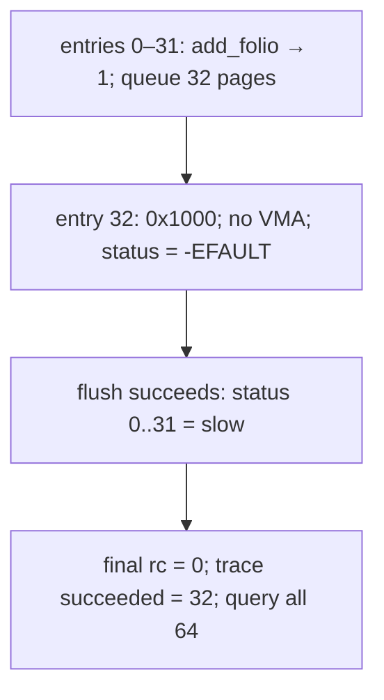

相對地，`invalid_target` 在第 2373–2377 行被拒絕，尚未進入 migration；實測使用者端為 `rc=-1, errno=19`（`ENODEV`），markers 之間沒有 migration events，64 頁的 after query 與 before 完全相同。

回傳碼不能當成逐頁失敗數的通用替代品。正值可能表示 migration 失敗及尚未嘗試的剩餘頁；本版的 per-entry lookup 錯誤又可能與 `rc=0` 同時存在。因此每次都保留 rc、errno、完整 status、有效旗標，以及獨立 after query。`INT_MIN` sentinel 沒被核心改寫時，仍是未知值。

### 5.6 讓閱讀結果可以被驗證

靜態閱讀形成假說，實際執行再檢驗。假說「非法 target 在 migration 前被拒絕」對應的證據是 `rc=-1`、沒有 migration events、query 不變；假說「混合 VA 的合法頁仍會完成移頁」對應的是 status 與 trace 成功數 32，以及其餘 32 頁位置維持不變。

需要停住程式觀察區域變數時，可用 GDB 的 `break`、`bt`、`frame`、`info args`、`info locals`、`next`、`step`、`finish`。`next` 跨過呼叫，`step` 嘗試進入有除錯資訊的函式，`finish` 執行到目前函式返回。這些是不同的問題：呼叫鏈用 `bt`，參數與分支用 frame/locals，跨系統呼叫後的核心函式則不能靠使用者空間 GDB 直接 `step` 進去。

目前 runner 沒有提供互動式 Guest GDB 停機模式；本教學的可重現流程使用已實作的 `make trace-test` 與原始證據。若另外加入 kernel GDB session，需要匹配 `vmlinux`、kernel symbols 與 QEMU gdbstub，且停住 vCPU 會改變 timeout 行為。它不能被當成本次 G5 已執行的證據。

<details>
<summary>自我檢查：只看到 mm_migrate_pages 成功 64，能否指出每個 VA 最後在哪裡？</summary>

不能。這兩個 migration tracepoints 提供一次 migration call 的彙總資訊，沒有列出本案例的逐 VA 最終 residency。必須把 marker 對齊該批，再讀 `trace_batches.jsonl` 的獨立 after query，並確認 query 沒有缺值及映射仍存在。
</details>

<details>
<summary>自我檢查：page_id、VA、PFN 與 node ID 有什麼差別？</summary>

`page_id` 是本專案映射內的索引；VA 是 `base + page_id × 4096`，由程序頁表解讀；PFN 是實體頁框編號；node ID 是記憶體所屬 NUMA 節點。搬移頁面時 page_id 與 VA 不變，PFN 和 node 可以改變。本專案用 query 驗證 node，沒有把 page_id 當成 PFN。
</details>

<a id="policy"></a>

## 6. Policy：熱度、容量與重試

這一節要回答三個問題：如何從存取次數辨認熱頁、如何在容量限制內決定移頁順序，以及移頁失敗後如何維持正確狀態。先讀懂每個 epoch 的資料流，再進入公式；否則很容易把「預計移到哪裡」和「核心實際把頁放在哪裡」混為一談。

### 6.1 三種資料各有不同責任

| 資料 | 誰產生 | 可以回答什麼 | 不能用來推論什麼 |
|---|---|---|---|
| `counts[page_id]` | `Workload::next_epoch()` | 這一輪存取各頁幾次 | 頁面現在位於哪個 node |
| `PolicyPage` | `PolicyCore` | 平滑熱度、分類、冷卻與重試時間 | 頁面已成功移到目標 node |
| `nodes[page_id]` | `move_pages` query | 查詢當下的 NUMA 位置 | 下次移頁必定成功 |
| `BatchResult` | `LinuxMigrator::move()` | 要求、回傳值與前後位置 | 整個實體裝置的記憶體狀態 |

`PolicyCore` 不保存 residency cache；它保存的是熱度和時間限制。外層 `run_policy()` 的 `nodes` 則保存最近一次 query 的觀察值，只能由 query-after 更新。每輪還會重新查詢整個 mapping，檢查這份觀察值是否仍成立。

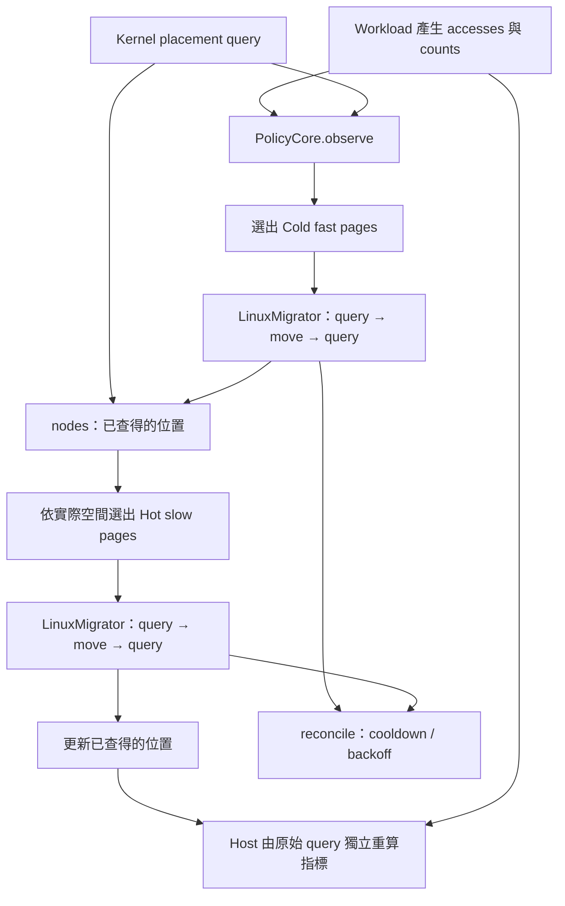

原始碼入口：[policy.hpp](../src/policy.hpp)、[PolicyCore::observe](../src/policy.cpp#L31)、[run_policy](../src/policy_run.cpp#L53)。

### 6.2 先建立可比較的工作負載

本實驗管理 128 MiB 匿名記憶體，使用 4 KiB base page，所以共有 32768 頁。熱頁集合是 6144 頁，即 24 MiB；fast 容量上限是 8192 頁，即 32 MiB。這兩者有意分開：容量限制約束實際 placement，熱頁集合則定義工作負載的局部性。

| 參數 | 本版設定 |
|---|---:|
| managed pages | 32768 |
| hot pages | 6144 |
| fast cap | 8192 頁 |
| 每輪 workload operations | 25000 |
| 每輪 migration attempt budget | 2048 頁 |
| 每批 migration 上限 | 256 頁 |
| epochs | 60，編號 0–59 |
| phase shift | epoch 30 |
| seeds | 1、7、42 |

`Workload` 先以 deterministic Fisher–Yates shuffle 排列 page IDs，再取兩組不重疊的 hot set。epoch 0–29 使用第一組，epoch 30–59 改用第二組。每次 operation 以 9/10 機率從當期 hot group 選頁，其餘從 cold group 選頁，再選一個 64-bit word 讀取並核對 pattern。4096-byte 頁有 512 個這樣的 word。

「9/10 機率」不表示每輪剛好有 22500 次 hot accesses；實際次數由 seed 決定。Host 必須重播同一份序列，不能用理論比例代替實際 counts。`SplitMix64::bounded()` 採 rejection sampling，避免直接 `% bound` 帶來的取餘偏差；每輪同時記錄 counts 與 trace hash，讓 Host 檢查工作負載是否一致。

三個 baseline 每次都建立新的 mapping、workload 和 core，避免前次執行留下的熱度或位置影響結果。

| Baseline | 初始位置 | 執行期間 |
|---|---|---|
| B0 | 全部 slow | 不移頁 |
| B1 | 先把第一組 hot set 移到 fast | 維持初始配置 |
| B2 | 全部 slow | 只依 counts 與 query placement 決定移頁 |

B1 使用初始 hot labels 是靜態對照組的定義。B2 的 `PolicyCore` 不接收 labels，也不知道 epoch 30 會切換 hot set；若把 `workload.hot(epoch)` 傳入 core，就等於把答案交給 policy，無法再檢驗它是否能由觀察辨認熱度。

原始碼：[workload.hpp](../src/workload.hpp)、[workload.cpp](../src/workload.cpp)。

### 6.3 一輪 epoch 的時間順序

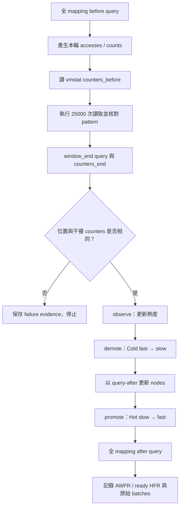

`before` 是 workload 開始前的位置；`window_end` 是 workload 結束、policy 尚未移頁的位置；`after` 是本輪 policy 全部移頁結束後的位置。這三個時間點不能互換。

工作負載視窗內，程式要求 `before == window_end`，並要求六個 kernel counters 沒有改變：`pgmigrate_success`、`pgmigrate_fail`、`pswpin`、`pswpout`、`pgscan_kswapd`、`pgscan_direct`。若 migration、swap 或 reclaim 干擾了視窗，該輪標為 `INVALID_RESIDENCY_WINDOW`，不能再用端點 placement 推算期間命中率。自動 NUMA balancing、KSM、自動 demotion 也被關閉，Guest 不配置 swap。

這些是受控實驗的有效性條件。端點 query 與全域 counters 並不是逐次 access 的硬體位置追蹤；它們用來排除目前實驗已知的 placement 干擾。移頁與 full scans 位於計分工作負載之外，不能把它們造成的 cache 狀態解釋為實體 CXL 延遲量測。

關鍵執行順序摘自 [policy_run.cpp](../src/policy_run.cpp#L195)：

```cpp
core.observe(epoch, trace.counts, window_end.status);
const auto demote = core.select_demotions(epoch, nodes, epoch_budget);
attempted += demote.size();
succeeded += execute(demote, slow, static_cast<int>(epoch), batches);
// nodes contains only query-after truth: failed demotions never free slots.
const auto promote = core.select_promotions(epoch, nodes, epoch_budget - attempted);
attempted += promote.size();
succeeded += execute(promote, fast, static_cast<int>(epoch), batches);
```

先降級、後升級，因為必須先確認 fast 實際釋出多少位置，才能決定可以升級多少頁。

### 6.4 EWMA：讓單輪次數變成可累積的熱度

對每頁先算本輪訊號，再與上一輪分數平均：

```text
instant[e] = min(1, counts[e] / 2)
score[e]   = 0.5 × instant[e] + 0.5 × score[e−1]
initial score = 0
```

`counts/2` 是浮點除法。count 0、1、至少 2，分別對應 instant 0、0.5、1；更高次數不再增加本輪訊號。這是本實驗明確選定的估計器，不是 CXL 或 Linux 強制規則。

單次高分不立即分類為 Hot；分數降到邊界附近也不立刻反轉分類。實作使用兩個門檻和連續輪數：

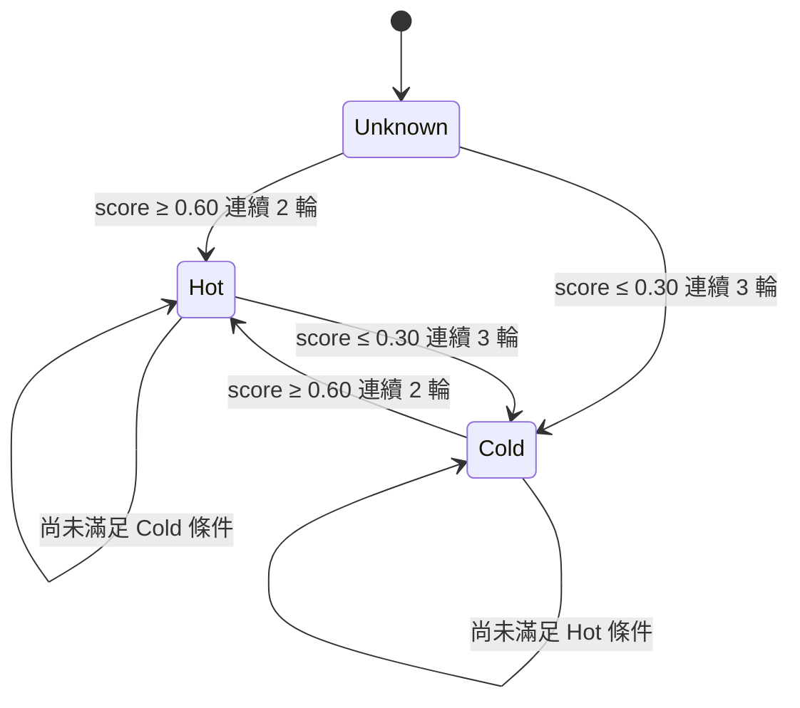

中間帶 `0.30 < score < 0.60` 維持既有分類，但 high/low streak 會歸零；streak 要求「連續」，不是累積命中次數。以下數列可逐行對照 [policy_tests.cpp](../tests/cpp/policy_tests.cpp)：

| epoch | count | instant | score | 分類變化 |
|---:|---:|---:|---:|---|
| 0 | 2 | 1 | 0.5 | Unknown，未達高門檻 |
| 1 | 2 | 1 | 0.75 | high streak 1，仍 Unknown |
| 2 | 2 | 1 | 0.875 | high streak 2，成為 Hot |
| 3 | 1 | 0.5 | 0.6875 | 維持 Hot |
| 4 | 0 | 0 | 0.34375 | 中間帶，維持 Hot |
| 5 | 0 | 0 | 0.171875 | low streak 1，維持 Hot |
| 6 | 0 | 0 | 0.0859375 | low streak 2，維持 Hot |
| 7 | 0 | 0 | 0.04296875 | low streak 3，成為 Cold |

注意第一輪 score 只有 0.5，因此連續高存取的頁最早在 epoch 2 才變成 Hot。Hot/Cold 是分類；score 是排序依據；兩者不是同一欄資料。

### 6.5 四種限制分別防止什麼問題

| 限制 | 計算基礎 | 防止的問題 |
|---|---|---|
| fast cap | query 中實際位於 fast 的頁數 | 配置超出實驗設定的 fast 容量 |
| attempts budget | 本輪已送出要求的頁數 | 失敗重試或雙方向移頁無上限 |
| cooldown | 上次經 query 證明成功移頁的 epoch | 同頁頻繁來回移動 |
| EBUSY backoff | 連續 busy 失敗次數與 retry epoch | 對暫時無法移動的頁反覆施壓 |

候選選擇有固定順序：demotion 只選 Cold 且實際在 fast 的頁，score 由低到高；promotion 只選 Hot 且實際在 slow 的頁，score 由高到低。相同 score 以 page ID 小者優先，確保相同輸入得到相同結果。

兩個方向共用每輪 2048 頁 attempts，而不是每方向各 2048。失敗也消耗 attempt；同頁同一輪最多要求一次。每次移頁 syscall 最多 256 頁，所以挑選出的候選仍需分批送出。

容量必須在 query-after 後重算。假設 fast cap 為 2、當下已有 2 頁在 fast，policy 要 demote 這 2 頁：若全部 EBUSY，就沒有 promotion 空間；若僅 1 頁真的到 slow，後續最多升級 1 頁。要求 2 頁降級不等於釋出 2 個位置。

成功移頁在 epoch 4 發生時，`epoch - last_move_epoch < 5` 的輪次會排除該頁，因此最早 epoch 9 才能再移。未成功的要求不啟動 cooldown。

EBUSY 使用 2、4、8、16、32 epochs 的延遲，之後封頂 32。若第一次在 epoch 2 失敗，持續 busy 的嘗試可能發生在 2、4、8、16、32、64、96。逐頁 `status=-EBUSY` 與整批 `rc=-1, errno=EBUSY` 都會更新 backoff；成功且 query 證明位置改變後，清除 busy 計數與 retry epoch。

原始碼：[PolicyCore::select](../src/policy.cpp#L57)、[PolicyCore::reconcile](../src/policy.cpp#L84)。

### 6.6 syscall 失敗與 placement 成功可以同時存在

`rc / errno / status` 描述這次系統呼叫；query 描述獨立查詢當下的位置。兩者都要保存，不能互相覆蓋。核心可能在回報整批錯誤前已處理部分頁，程式不能因 `rc=-1` 就假設所有頁都沒移動。

`reconcile()` 設定成功移頁時間的條件摘自 [policy.cpp](../src/policy.cpp#L108)：

```cpp
if (result.query_before_node >= 0 && result.query_before_node != target &&
    result.query_after_node == target) {
    page.last_move_epoch = epoch;
    page.busy_failures = 0;
    page.retry_epoch = 0;
}
```

這不會把 syscall 錯誤改成成功；原始 rc/errno 仍在 `BatchResult` 和 JSONL 中。它只承認 query 已證明的狀態改變。反過來，即使 status 看似目標 node，只要整批 rc=-1，該 status 仍標無效；如果 query-after 沒有到達目標，就不能算移動成功。

測試還覆蓋 `rc>0` 且某些 status 未被核心填寫的情況。未觸碰的 entry 保持 `INT_MIN` sentinel，不能當成 node 0，不能算成功，也不能憑空算成 EBUSY。

### 6.7 評分：本輪命中率與輪末準備程度

兩個指標的時間基準不同：

```text
AWFR[e] = Σ counts[e][p] × I(before[e][p] == fast) / 25000

ready HFR[e] = Σ I(after[e][p] == fast), p ∈ 當期 hot set / 6144
```

AWFR 是本輪 workload accesses 的 fast 比例，使用 workload 前的 `before`。ready HFR 是 policy 完成後，當期 hot set 已有多少頁準備在 fast，使用 `after`。不能把輪末移頁結果回填成本輪早已完成的存取命中率。

Host 在 [validate_epoch](../scripts/validate_policy.py#L203) 重播 counts、驗證 trace hash、核對每批前後 query，再重算兩個指標。它也檢查 B0 全 slow、B1 沒改初始配置、fast cap 與 attempts 沒超限；不是只相信 Guest summary 的數字。

G3 要求 B2 每個 seed 最後 10 輪 ready HFR 中位數至少 0.85，且切換後 20 輪內至少一次達到 0.80。epoch 30 是切換後第 1 輪，所以 recovery epoch 37 表示第 8 輪。B1 切換後的 ready HFR 可以是 0，但 AWFR 仍可能非零：cold group 仍可能抽到原先留在 fast 的頁。

<details>
<summary>自問自答：為何一輪 ready HFR 已達 1，AWFR 卻仍較低？</summary>

ready HFR 在移頁完成後才計算；本輪 accesses 發生在移頁之前。另一方面，workload 還包含 cold accesses；即使所有 hot pages 都在 fast，也不保證所有 accesses 都命中 fast。判讀時要先確認分母、取樣時間與位置資料來源。

</details>

<details>
<summary>自問自答：為何失敗的 demotion 也要扣 budget？</summary>

budget 約束的是要求與重試壓力，不只是成功搬移的量。失敗 syscall 仍花時間並進入核心。若只扣成功頁，持續 EBUSY 就可能在一輪中無限制嘗試，失去上限的意義。

</details>

<details>
<summary>自問自答：調大 score 門檻可以證明 policy 變好了嗎？</summary>

不能只看最後一個指標。要保留相同 seeds、phase shift、容量、attempt budget 和評分條件，比較 cold-start、切換後恢復、穩態 HFR/AWFR 與 migration attempts。調參後還需檢查是否只是降低移動量，卻延後了熱頁就緒時間。

</details>

<a id="evaluation"></a>

## 7. 評估設計：避免把結果算得過好

### 7.1 為什麼至少需要 B0／B1／B2

B0 全部放 slow，提供沒有 placement 調整的基線。B1 把第一階段 hot set 放到 fast，之後保持不動，用來觀察固定配置遇到 phase shift 的結果。B2 才根據每輪 counts 推測熱度並調整，**PolicyCore 不會取得當期 hot-set labels**。若把 labels 交給 policy，策略就直接取得答案，不能用來驗證觀測與決策能力。

三個 seed、三種 baseline 都使用相同的標準 profile：128 MiB、32768 頁、6144 個 hot pages、每輪 25000 次讀取、60 epochs，於 epoch 30 切到另一組互斥的 hot pages。90% 是每次操作選 hot group 的機率，不保證每輪剛好有 22500 次 hot accesses。

Workload 的可重播性來自釘定的整數運算、SplitMix64、無偏有界取樣與 Fisher–Yates，而不是依賴不同標準函式庫可能有差異的 `std::shuffle` 分布。Host Python 獨立重播 access stream、counts 與 hash；僅收到一個「seed 相同」的宣告並不夠。來源：[src/workload.cpp](../src/workload.cpp)、[scripts/validate_policy.py](../scripts/validate_policy.py)。

### 7.2 同一輪中的三個位置快照

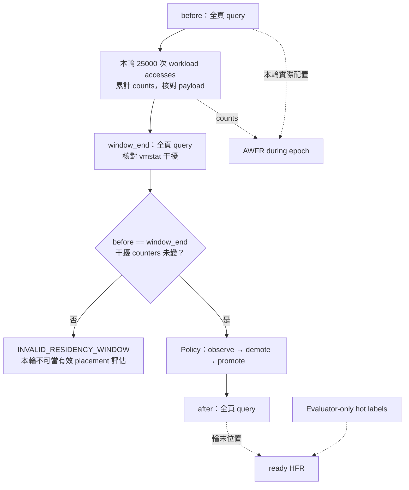

`before == window_end` 是本版把「每個 access 發生時的位置」化約為同一份快照的條件。若存取期間已有未知遷移，拿 before 乘 counts 會失真。因此同時檢查 `pgmigrate_success/fail`、`pswpin/out`、`pgscan_kswapd/direct`。這些是干擾偵測，不是逐 VA 的來源證明；每頁位置仍由 query 提供。

### 7.3 兩個指標回答不同問題

令 `fast` 為 fast node，`counts[p]` 為本輪對頁 p 的存取次數，`H_e` 為本輪真正的 hot set：

```text
AWFR(e) = Σ counts[p] × 1(before[p] == fast) / 25000

ready_HFR(e) = Σ 1(after[p] == fast), p ∈ H_e / 6144
```

AWFR 是 Access-Weighted Fast Residency，描述本輪操作有多少比例發生在配置於 fast 的頁。Ready HFR 是 hot-page fast residency，描述 policy 完成後有多少 hot pages 已準備在 fast。兩者都不是 cache hit rate，也不是延遲或 speedup。

實作中的核心算式為：

```python
awfr = sum(count for count, node in zip(counts, before)
           if node == fast) / OPERATIONS
hfr = sum(after[page] == fast for page in labels) / HOT_PAGES
```

來源：[scripts/validate_policy.py 的 `validate_epoch`](../scripts/validate_policy.py)。Evaluator 不讀 PolicyCore 的熱度或自報成功數來替代 query。

**四頁小例子：**本輪 counts 是 `[8, 1, 1, 0]`，只有 page 1 在 fast，總計 10 accesses。此輪 AWFR=1/10。輪末把 page 0 移到 fast 後，即使 hot set `{0}` 的 ready HFR=1，也不能把剛完成的 10 次操作回填為 AWFR=8/10。這個簡化例子用 10 作分母；正式 profile 的分母固定為 25000。

### 7.4 Phase shift 如何看出差異

本機保存的完整回歸在 2026-11-06（台灣時間）完成。以下是該次原始結果的摘要，不是對其他機器的效能承諾：

| Baseline | 最後 10 輪 ready HFR 中位數 | 最後 10 輪 AWFR | 解讀 |
|---|---:|---:|---|
| B0，三 seeds | 0 | 0 | 全部 slow |
| B1，三 seeds | 0 | 約 2.29–2.33% | 舊 hot set 仍在 fast，但新 hot set 與它互斥 |
| B2，seed 1 | 1.0 | 90.10% | counts 驅動的配置跟上新 hot set |
| B2，seed 7 | 1.0 | 89.993% | 同上 |
| B2，seed 42 | 1.0 | 89.9632% | 同上 |

B1 的 ready HFR 雖然為 0，AWFR 仍可能大於 0：10% 的 cold accesses 仍會抽到舊 hot set 中的頁。因此不應把「當期 hot pages 都不在 fast」解讀成「沒有任何 access 在 fast」。

G3 要求 B2 最後 10 輪 ready HFR 中位數至少 0.85，並在 epoch 30–49 內至少有一次達到 0.80。這次三個 seed 都於 epoch 37 達標。Epoch 從 0 起算，切換發生在 30，所以 37 是切換後第 8 輪。門檻先由 profile 固定，不能看結果再調低。

### 7.5 重算保存結果

```bash
# 不編譯、不開 VM；會檢查目前 binary/image/config 與保存 gates 是否相符
make demo

# 只摘要目前 G3 指向的實驗，不載入約 144 MiB raw JSONL
python3 - <<'PY'
import json
from pathlib import Path
gate = json.loads(Path("results/gates/M2.json").read_text())
run_id = gate["runs"][0]["run_id"]
report = json.loads((Path("results/runs") / run_id / "policy_verified.json").read_text())
for row in report["experiments"]:
    print(row["baseline"], row["seed"], row["last10_ready_hfr_median"],
          row["awfr_last10"], row["recovery_epoch"])
PY
```

`make demo` 會重新執行 Host validators；後面的 Python 僅顯示已產生的摘要，兩者的驗證強度不同。原始 policy.jsonl 約 144 MiB，validator 逐行處理；不要為了縮小檔案刪除 query 或失敗 entries。

<details>
<summary>自問：B2 的 ready HFR=1，能宣稱實體 CXL 效能提升嗎？</summary>

不能。它證明在受控 workload 下，hot pages 的配置符合角色定義。QEMU、full scan、cache 狀態、真實 CXL 延遲與裝置頻寬都沒有在這個指標中被量化。效能實驗需要另外的硬體、測量設計與干擾控制。

</details>

<a id="drain"></a>

## 8. 撤離：從 managed pages 到 block offline

移走程式管理的頁面，只完成撤離的一部分。CXL 記憶體要真正離開 system RAM，還需停止使用 mapping、讓核心 offline 對應 memory blocks，最後解除 DAX 與 CXL region。這些步驟的成功條件不同，必須分開驗證。

本版 `offline` 是獨立 scenario：重新建立 128 MiB mapping，全部配置在 CXL，再撤離到 DRAM。它沒有與正常 policy 並行的 worker，也沒有實作持續運作中的 live policy hot-remove；因此 `workload_stopped` 的意義是此 scenario 自該點起不再存取 mapping。

### 8.1 兩層責任：C++ 撤頁，Guest helper 移除記憶體

| 層次 | 負責的動作 | 完成後可以宣告 |
|---|---|---|
| `DrainController` / `run_drain()` | 容量檢查、限次移頁、query、資料核對、checked munmap | 已準備好進入 offline，仍為 DRAINING |
| `guest/cxl_offline.py` | 範圍白名單、逐 block offline、DAX/region teardown、readback | 實際 OFFLINE |
| Host evaluator | 重新檢查 raw drain 與 lifecycle 證據 | G4 是否成立 |

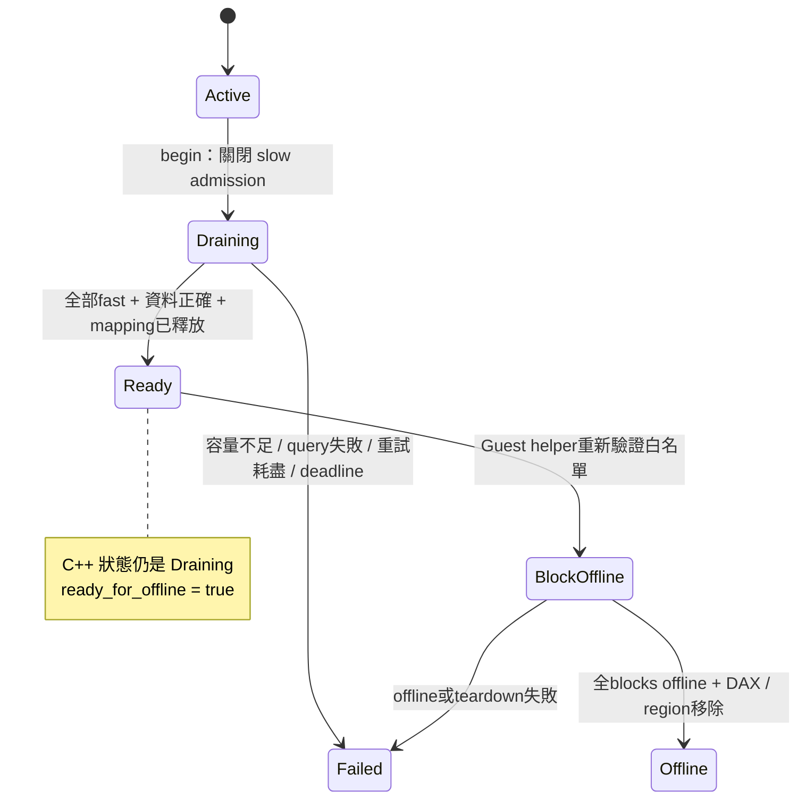

圖中的 Ready 是教學上標出的完成條件，不是 C++ enum。`DrainState` 實際只有 `Active`、`Draining`、`Failed`；`OFFLINE` 留給 Guest helper 在真正 sysfs 操作完成後發布。

原始碼：[drain.hpp](../src/drain.hpp)、[drain.cpp](../src/drain.cpp)、[run_drain](../src/drain_run.cpp#L26)。

### 8.2 先關閉 admission，再檢查容量

`begin()` 進入 Draining 後，只允許向 fast 的移頁要求；不能再把頁送回即將撤離的 slow node。容量不足會進入 Failed，後續 selection 和 migration 都被拒絕。

容量條件是：

```text
required_bytes = slow_pages × 4096 + 256 MiB
Guest MemAvailable ≥ required_bytes
fast-node MemFree ≥ required_bytes
```

標準 scenario 的 32768 頁是 128 MiB，因此需求為 384 MiB。全域 `MemAvailable` 和 fast-node `MemFree` 必須各自滿足條件；不能將兩者相加。全域可用量可能包含即將撤離的 slow memory，只有全域條件不足以證明 DRAM 能承接頁面。

這是保守的前置 guard，不是對未來配置成功的承諾。檢查後核心仍可能因不可移頁、配置失敗或其他原因拒絕 migration，所以後續每頁 query 與 block offline readback 都不能省略。

### 8.3 撤離不能沿用一般 policy 的容量與節奏限制

一般 policy 的 fast cap 是 32 MiB，但 drain 要把整份 128 MiB 移回 DRAM；若沿用該 cap，撤離不可能完成。因此 drain 使用自己的 controller，不套用 policy fast cap、epoch budget 或 cooldown。

它保留三種有明確目的的界線：每批最多 256 頁、每頁最多 3 次 attempts、Guest deadline 60 秒。下一批只選 query 仍在 slow、且 attempts 未耗盡的頁。成功與否仍依 query-before/query-after，不能用 syscall status 取代位置證據。

```text
run_drain()
 ├─ Mapping(128 MiB, slow)
 ├─ write_pattern(generation=7)
 ├─ initial full scan + full query
 ├─ controller.begin(capacity)
 ├─ while still on slow
 │   ├─ check deadline
 │   ├─ controller.select(nodes)
 │   ├─ migrator.move(batch, fast)
 │   │   └─ query-before → move_pages → query-after
 │   ├─ emit raw batch
 │   ├─ controller.reconcile(result)
 │   └─ update nodes from query-after
 ├─ final full query + full scan
 ├─ mark workload stopped
 ├─ mapping.release()
 └─ controller.finish(final_nodes, pattern_ok, mapping_released)
```

deadline 在 syscall 前後檢查，無法中斷卡在核心內的 syscall。Host 的 300 秒 VM timeout 是外部保護；不能在原呼叫尚未結束時另啟一個移頁或 rollback，讓兩個未知進度的操作競跑。

### 8.4 為何必須 checked release

最終 query 要證明所有 managed pages 都在 fast；完整 pattern scan 要證明資料未毀損。兩項成立後，程式停止後續存取，再顯式呼叫 `Mapping::release()`。只有 `munmap()` 成功，才把 mapping pointer 清空並在報告標示 `mapping_released=true`。

摘自 [guest_runtime.cpp](../src/guest_runtime.cpp#L80)：

```cpp
void Mapping::release() {
    if (!data_) return;
    if (::munmap(data_, bytes_) != 0)
        throw std::runtime_error("munmap: " + std::string(std::strerror(errno)));
    data_ = nullptr;
}
```

destructor 適合清理資源，但不能替代這個成功證據：teardown 要根據「確實完成釋放」作決定，而不是依賴函式離開時曾嘗試清理。`controller.finish()` 同時要求全部 fast、pattern 正確與 mapping 已釋放；任一條件不成立就不能授權 offline。

### 8.5 managed mapping 與整個 CXL range 是不同範圍

本版只追蹤自己的 128 MiB，但 CXL region 有 1 GiB，對應 8 個 128 MiB memory blocks。自己的頁全離開 slow，不表示其他核心或使用者頁面也全離開這個 range。

Guest helper 會重新讀取 live sysfs 與 `/proc/iomem`，驗證 region、DAX device、node、resource start/size 與 Movable blocks 的關聯，列出這次操作的精確白名單。它只操作這個 range，不以「所有 node1 memory」或「所有 offline-capable blocks」作替代。node ID、region 名稱與位址都應從當次 topology 取得，不能把某次實驗的 node1 或 memory42–49 硬編碼成通用規則。

核心對每個 block 的 offline 操作仍可能失敗；這正是不能只看 managed query 就宣告完成的原因。

### 8.6 真正的移除順序與每一步 readback

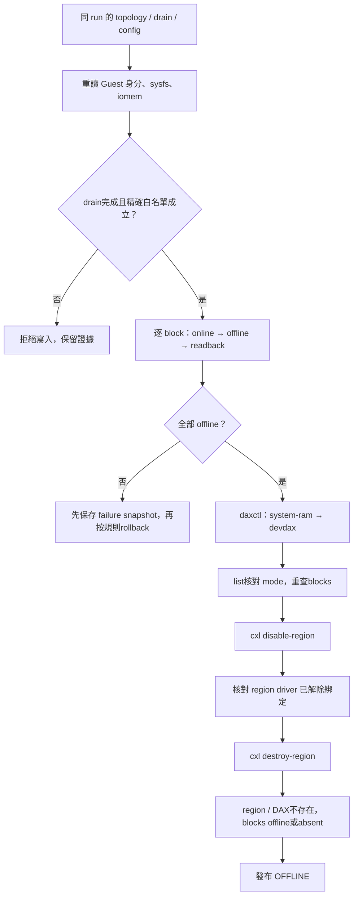

helper 執行下列命令的名稱由當次 topology 決定，這裡以變數表示；應從 Host 的 `make offline-test` 走完整流程，不在 WSL Host 手動操作記憶體 sysfs。

```text
daxctl reconfigure-device --mode=devdax <daxdev>
daxctl list -D
cxl disable-region <region>
cxl destroy-region <region>
cxl list -R
daxctl list -D
```

流程沒有用 force 跳過仍在線上的 blocks。每次寫入都記錄 before/requested/after/rc/errno，再確認讀回狀態。切換 devdax 後核對實際 mode；disable 後檢查 driver unbound；destroy 後同時核對 sysfs 與 CLI list，確認 region、DAX 不存在，原 blocks 只能是 offline 或 absent。

原始碼：[validate_plan](../guest/cxl_offline.py#L26)、[Offline.execute](../guest/cxl_offline.py#L224)。Host 在 [validate_offline.py](../scripts/validate_offline.py) 重新驗證這條 lifecycle，不只檢查最終 summary 字串。

### 8.7 rollback 只能處理已知、已完成的變更

若第 4 個 block offline 失敗，程式先保存失敗當下白名單中所有 blocks 的狀態，再倒序處理這次已確認 offline 成功的 blocks。原本不屬於本次成功清單的 block 不會被盲目寫回；unreadable 狀態也不猜測。

即使某次 write 回傳錯誤，核心仍可能改變了部分狀態。因此「成功清單都 rollback 完」不等於「原始範圍已完整復原」。最終 `rollback_complete=true` 的條件是重新讀取原白名單，全部都回到 online。

如果操作 timeout、且無法確認核心內的 write 是否已結束，會標示 `unknown_inflight`，保存證據並停止，不另外開始 rollback。rollback 自己再失敗，也要保留失敗與不完整狀態，不能為了呈現成功而繼續 teardown。

這個 rollback 範圍是 block offline 階段的補償；不表示能在任意 DAX/region teardown 失敗後自動重建整個裝置。各階段只能宣告已實際驗證的狀態。

原始碼：[write](../guest/cxl_offline.py#L170)、[rollback](../guest/cxl_offline.py#L193)。測試分為 [DrainController contracts](../tests/cpp/drain_tests.cpp)、[MockSysfs cases](../tests/test_offline.py) 與 [Host evidence validator](../tests/test_offline_evidence.py)。MockSysfs 驗證失敗分支的控制流程，不代表真實 Guest 已注入同樣的核心故障。

<details>
<summary>自問自答：為何 managed pages 全在 fast，offline 還是可能失敗？</summary>

managed mapping 只有 128 MiB，region 是 1 GiB。其餘頁面可能被其他使用者或核心使用，也可能暫時不可移動。query 只證明本程序提供的 VA；block offline 才由核心處理該實體區段的完整撤離條件。

</details>

<details>
<summary>自問自答：容量不足時，可以先關掉一半 CXL blocks 試試嗎？</summary>

本版流程不這樣做。容量 guard 失敗後不執行 migration 或 offline，避免在缺乏承接空間時改變裝置生命週期。若要研究分段撤離，需要另訂範圍、容量與失敗契約，不能只移除 guard。

</details>

<details>
<summary>自問自答：為何 C++ drain 成功仍保留 DRAINING？</summary>

C++ 只能證明自己管理的頁面、資料與 mapping 已完成撤離。它尚未操作 memory blocks，也不知道 DAX/region teardown 是否成功。保留 DRAINING 能避免把「準備完成」誤報成「記憶體已離線」。

</details>

<details>
<summary>自問自答：timeout 之後立即 rollback，為何可能更危險？</summary>

timeout 只表示使用者空間沒有取得完成結果，未必表示核心操作已停止。若原 offline 還在執行，同時寫 online_movable 會引入未知順序。先保存 unknown-inflight 狀態並停止，才不會製造第二個無法解釋的狀態變更。

</details>

<a id="trace-runtime"></a>

## 9. 用 trace 核對實際執行

M4 的問題是：保存的 syscall 結果，能否和同一個程序、同一次呼叫期間的核心 migration events 相符？答案需要三條證據鏈：使用者端 rc/errno/status、marker 範圍內的核心事件，以及呼叫後獨立 query 的位置。資料完整性另外用完整 payload 掃描檢查。

### 9.1 重跑與查閱入口

```bash
# Host，專案根目錄；建立必要的兩個 binary 並啟動指定 Guest。
make trace-test

# 只重算已有且符合目前 inputs 的完整 G0–G5 證據，不啟動 Guest。
make demo

# 查閱最近一次 M4 gate 與 run_id。
python3 -m json.tool results/gates/M4.json
```

`make trace-test` 在同一台 Guest 先跑 Linux 上游 MM migration selftest 的 `migration.private_anon`，再跑本專案的五個 cases。上游 baseline binary 由釘版核心來源建置，保留 source hashes、binary hash 與 TAP；`SKIP` 是 `BLOCKED`，不算成功。baseline 驗證一般匿名頁 migration 行為，五個 cases 負責本專案特定的 marker／query 對照。

### 9.2 先準備 collector，才允許 target 開始

[`guest/trace.py`](../guest/trace.py) 的 `collect()` 先呼叫 `guest_identity()`，確認 pinned Guest kernel、QEMU DMI 與 Guest root，通過後才 mount tracefs 或啟動子程序。它建立 `/sys/kernel/tracing/instances/tierlab_RUN_ID`，不重用既有 instance，也不清除別人的 instance。

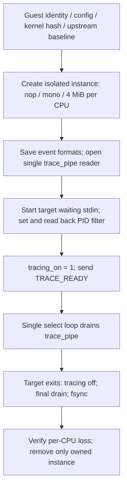

「啟動 target」和「允許 workload 執行」必須分開。target 的 `wait_for_collector()` 最多等 10 秒；收到精確的 `TRACE_READY` 後才建立 mapping 與執行測試。collector 在通知前，已將 `set_event_pid` 寫成 target PID 並讀回核對。如此可避免先移完第一批，才補上 filter 的競態。

```python
# guest/trace.py，啟動 target 後的關鍵順序
instance.write("set_event_pid", process.pid)
if (instance.path / "set_event_pid").read_text().split() != [str(process.pid)]:
    raise ValueError("Trace PID filter readback mismatch")
instance.write("tracing_on", 1)
process.stdin.write(b"TRACE_READY\n")
process.stdin.close()
```

tracefs 使用 `current_tracer=nop`，但明確啟用 `migrate:mm_migrate_pages_start` 與 `migrate:mm_migrate_pages`。`nop` 表示不開 function tracer，不表示 event tracing 關閉。`trace_clock=mono` 提供同一時鐘域的排序；這裡不能拿 Guest 的時間戳與 Host 的 wall clock 直接相減。

### 9.3 五個 cases 與預期狀態

| batch | 輸入與操作 | 獨立 after query | 實測 migration 成功數 |
| --- | --- | --- | --- |
| 0 / roundtrip_out | 64 頁 fast → slow | 64 頁皆 slow | 64 |
| 1 / roundtrip_back | 64 頁 slow → fast | 64 頁皆 fast | 64 |
| 2 / mixed_va | 前 32 頁 → slow，再加非法 VA 0x1000 | 前 32 slow，後 32 fast | 32；非法 VA 的 status=-EFAULT |
| 3 / mixed_return | 前 32 頁 → fast | 64 頁皆 fast | 32 |
| 4 / invalid_target | 前 32 頁 → INT_MAX | 64 頁不變，皆 fast | 0；rc=-1、errno=ENODEV |

映射共 64 × 4096 = 262144 bytes，先以 generation 11 寫入 pattern，每批結束掃描全部 256 KiB。所有 query 都涵蓋完整 64 頁，直到最後一筆 complete 記錄仍保有 mapping，因此可以檢查前一批的 after 是否接得上下一批的 before。

[`src/trace_run.cpp`](../src/trace_run.cpp) 的 begin/end markers 只包住真正的 move syscall。before query 在 begin 前；after query 和 payload scan 在 end 後。這能縮小事件歸屬範圍，也避免把 query 誤認為另一個 migration call。end marker 寫入若失敗，程式仍會保存已執行 syscall 的結果、after query 與 payload scan，再回報 FAIL；不能因為記錄邊界壞掉，就遺失已經發生的副作用。

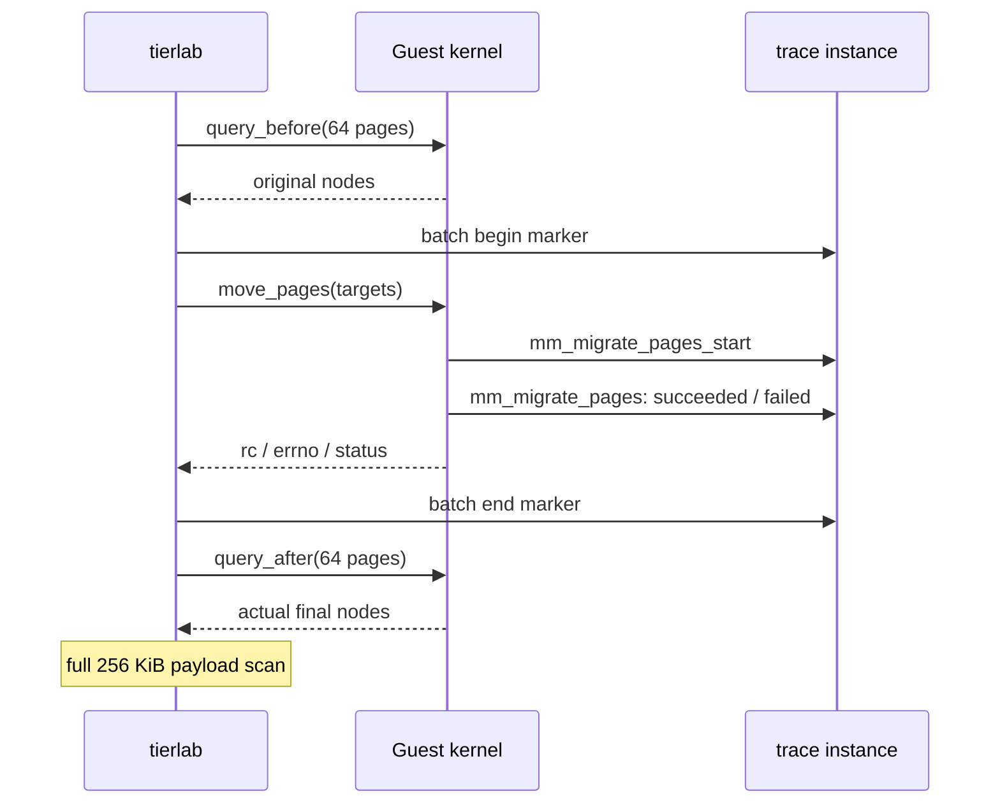

marker 是使用者程式寫入 tracefs 的邊界；start/finish 是核心在 migrate_pages() 中發出的彙總事件。非法 target 的 begin/end 之間沒有 migration events。

### 9.4 逐欄解讀一筆真實 trace

以下節錄自保留的 run `84fd73b3237944dcb46b17b2f33d9faf`，PID 為 283。空白僅為排版縮減，欄位值維持原始內容：

```text
tierlab-283 [003] ...1. 23.113138: tracing_mark_write: tierlab 84fd73b3237944dcb46b17b2f33d9faf 0 begin
tierlab-283 [003] ..... 23.113453: mm_migrate_pages_start: mode=MIGRATE_SYNC reason=syscall_or_cpuset
tierlab-283 [003] ..... 23.114230: mm_migrate_pages: nr_succeeded=64 nr_failed=0 nr_thp_succeeded=0 nr_thp_failed=0 nr_thp_split=0 nr_split=0 mode=MIGRATE_SYNC reason=syscall_or_cpuset
tierlab-283 [003] ...1. 23.114264: tracing_mark_write: tierlab 84fd73b3237944dcb46b17b2f33d9faf 0 end
```

`tierlab-283` 是 task 名稱與 PID；`[003]` 是記錄事件的 Guest CPU；後面旗標描述當下執行 context，不能拿來當成功狀態；小數是所選 clock 的秒數。`reason=syscall_or_cpuset` 是核心 `MR_SYSCALL` 的顯示名稱，因此單靠 reason 仍不足以辨識本專案的某一批，必須再核對 PID 與 markers。

這筆 finish 表示該 migration call 成功 64 個 base pages，失敗、THP 與 split 計數都是 0。它不包含來源／目的 nid，也不包含各 VA。完整事件格式另存 `trace_formats/` 並計算 hash，避免以錯版本欄位解析資料。四個有效 migration cases 共得到 8 筆核心事件，加上 10 筆 markers，這次總共 18 筆。

> **時間差的解讀範圍。**start 到 finish 的差值涵蓋這次核心 migration call 的執行區間，可能包含配置、鎖競爭、排程與 tracing 成本。QEMU backend 沒有建立實體 DRAM/CXL 的完整延遲模型；不能把這個數字當成實體 CXL 存取延遲或應用程式加速比。

### 9.5 trace_pipe 為什麼只能有一個 reader？

`trace_pipe` 是消費式讀取介面。兩個 reader 同時讀同一個 instance，可能各拿到部分事件，任何一邊都不再持有完整序列。本 collector 只開一個 nonblocking fd，在同一個 `select` 迴圈持續讀取；target 結束後先關 tracing，再 drain 剩餘可讀資料，最後 flush/fsync。

tracefs 的 pipe 不適合用「等待 EOF」作為結束條件。這裡遇到 `EAGAIN`/`EWOULDBLOCK` 代表目前已讀完可用資料；真正的 read error 必須失敗。報告中的 `eof_drained=true` 是專案沿用的欄位名稱，具體意思是停 tracing 後完成最後 drain，不表示核心 tracefs 發出了一個一般檔案式 EOF。

每個 CPU 的 `stats` 在前後各保存一次，CPU coverage 必須一致，`overrun`、`commit overrun`、`dropped events` 都必須是 0。只見到「沒有事件」無法排除 buffer loss；本專案還要求完整 markers、預期 event pairs、trace hash、尾端換行與 target exit 0。loss 為 0 是必要條件，完整性仍由這些條件一起建立。

### 9.6 Host evaluator 如何避免自己相信自己

[`scripts/validate_trace.py`](../scripts/validate_trace.py) 重新讀取 Guest 保存的原始內容，先驗 topology，再驗每批 VA、status 和完整 query chain，最後讀 trace。它不只接受 Guest 報告裡的 `passed=true`。

| 輸入 | 重算內容 | 會拒絕的例子 |
| --- | --- | --- |
| `trace_batches.jsonl` | profile、VA 換算、逐批 before/after、status 有效性、完整掃描 | query 少一頁、錯目標、把 sentinel 當有效 |
| `trace.log` | PID、run/batch marker 次序、start/finish 配對、彙總成功數 | 錯 PID、巢狀批次、缺事件、事件在 marker 外 |
| `collector.json` 與 formats | hash、clock、enabled events、全 CPU loss、cleanup | 截斷檔案、hash 不符、任何 loss、清理未完成 |
| 兩份 TAP 與 upstream build metadata | 精確 testcase、PASS 無 SKIP、binary/source provenance | 跑錯 testcase、SKIP、過期或不匹配 binary |

驗證器還會複製真實 trace 到記憶體，分別刪除 completion event、改錯 batch marker、截斷尾端，確認三種損壞都被拒絕。這些結果標成 `evidence_basis=modeled`，因為改的是證據副本，沒有對核心注入故障。原始 trace 不會被覆寫。單元測試另外覆蓋合成格式與破損案例，兩者也不能當成硬體故障實測。

### 9.7 不用猜 run 路徑，直接讀 gate 指向的證據

```bash
# Host；在專案根目錄執行。只讀最近 gate 指向的 artifacts。
python3 - <<'PY'
import json
from pathlib import Path

gate = json.loads(Path("results/gates/M4.json").read_text())
run_id = gate["runs"][0]["run_id"]
run = Path("results/runs") / run_id
print("run:", run)
print((run / "shared/trace.log").read_text())
for line in (run / "shared/trace_batches.jsonl").read_text().splitlines():
    event = json.loads(line)
    if event["kind"] == "batch":
        print(event["id"], event["name"],
              "rc=", event["syscall_rc"], "errno=", event["syscall_errno"],
              "status=", event["move_status"])
PY
```

閱讀順序是 gate 找 run → `meta.json`／config 核對 inputs → collector 核對收集狀態 → raw trace 與 raw batches → `trace_verified.json` 看重算。若改過程式或 image，舊 gate 的結果仍只是舊 inputs 的紀錄；`make demo` 會核對目前 artifacts，拒絕把不同 binary 的舊資料當作當前結果。

<details>
<summary>自我檢查：非法 target 沒有 migration events，就代表測試通過嗎？</summary>

還不夠。還要確認 target syscall 確實被呼叫、rc/errno 為失敗、markers 完整、相同 PID、loss 為 0、after query 與 before 相同。沒有事件也可能是沒開 event、filter 設錯或讀取損壞；完整證據鏈才能區分。
</details>

<details>
<summary>自我檢查：為什麼 upstream selftest 與本專案五個 cases 都要跑？</summary>

upstream testcase 保留上游原始程式，檢查一般匿名頁 migration 的基線；本專案 cases 則精確驗證自己的 markers、原始 syscall 記錄、混合非法 VA、非法 target 和獨立 query。兩者覆蓋不同契約，任何一邊 SKIP 或失敗都不能用另一邊的 PASS 取代。
</details>

<a id="tools"></a>

## 10. 工具練習：從問題選擇觀測方式

### 10.1 先寫問題，再選工具

同一個症狀可能跨過 userspace、syscall、核心和裝置狀態。先界定問題屬於哪一層，才知道工具看到的是原因、過程或結果。

| 要回答的問題 | 優先觀測方式 | 限制 |
|---|---|---|
| 誰呼叫這個函式、哪個分支改變狀態？ | 原始碼搜尋、GDB breakpoint／stack／locals | 靜態 call graph 不表示該次執行走過所有分支 |
| userspace 送出什麼 syscall、得到什麼 errno？ | 原始 adapter 紀錄；必要時 strace | strace 看不到完整核心內部 call graph，也不提供每個頁的完整因果 |
| 頁面現在在哪個 node？ | 獨立 `move_pages` query | 是取樣時刻的觀察，不是整段時間的歷史 |
| 核心有沒有進入 migration、成功幾頁？ | migration tracepoints + PID／marker | 彙總事件不列出每個 VA 的最終位置 |
| block 是否真的 offline、region 是否移除？ | Guest sysfs readback、cxl／daxctl list | managed mapping 沒有頁不等於整個 block 沒有使用者 |
| 核心為何拒絕某次操作？ | 第一筆 WARNING／error、stack、釘版 source／Kconfig | 最後一行 CLI 訊息可能是後續錯誤 |
| 編譯的是哪份程式、測試的是哪個映像？ | SHA256、build metadata、Guest provenance | 檔名或修改時間相同不代表內容相同 |

### 10.2 用 GDB 觀察 policy，不碰 Host 記憶體實驗

第一個 GDB 練習選 Host 的 `policy_tests`。它使用 FakeMigrator，可以觀察真實 PolicyCore 的決策與 reconciliation，不會在 WSL Host 執行真實移頁或 memory offline。

```bash
make tierlab-test
gdb -q build/tierlab/policy_tests
```

進入 GDB 後：

```gdb
set pagination off
break tierlab::PolicyCore::reconcile
run
bt 4
info args
print epoch
print target
print batch.syscall_rc
print batch.pages.size()
list
next
info locals
finish
continue
```

第一個 breakpoint 會在 `failures_capacity_and_cooldown()` 的失敗 demotion 情境觸發：epoch 2、target slow、兩個頁面未成功搬離 fast。先從 `bt` 找呼叫者，再讀 batch 的 before／after，不要先假設 `rc=0` 就代表每頁成功。`finish` 回到呼叫端後，沿測試的 assertion 讀「沒有任何 promotion 空間」的預期條件。

`next` 跨過目前行中的函式呼叫，`step` 嘗試進入有 debug line information 的函式，`finish` 執行到目前 frame 返回；`bt` 列出當下 stack，`frame N` 只切換觀察的 frame，不會倒轉執行。可參照 [GDB 的 stepping](https://sourceware.org/gdb/current/onlinedocs/gdb.html/Continuing-and-Stepping.html) 與 [backtrace](https://sourceware.org/gdb/current/onlinedocs/gdb.html/Backtrace.html)。

如果想知道是哪一次觀察把頁面變成 Hot，改在 `PolicyCore::observe` 停住，檢查 count、score 與 streak 的變化。不要在 GDB 用 `set variable` 把條件改成想要的答案後，仍把該次執行當正式驗收。

> userspace GDB 不能靠 `step` 直接走進 `mm/migrate.c`。本版已交付的核心觀測方式是 M4 trace；互動式 kernel GDB 需要另外準備相符的 `vmlinux` 與 QEMU gdbstub，並處理停住 vCPU 後的 timeout。教學不把尚未交付的除錯入口列為既有功能。

### 10.3 用 strace 辨認 API 邊界

以下選擇只讀 Host 條件並做 KVM 空 VM probe 的 doctor。它不啟動專案 Guest，不執行 Host 記憶體移頁：

```bash
mkdir -p build/docs-qa
strace -f -e trace=openat,ioctl -o build/docs-qa/doctor.strace \
  python3 scripts/doctor.py
grep -n '/dev/kvm\|KVM_GET_API_VERSION\|KVM_CREATE_VM' \
  build/docs-qa/doctor.strace
```

關注 `/dev/kvm` 的 open 是否成功、API ioctl 的結果是否為 12、空 VM fd 是否建立。不同 strace 版本可能以十六進位 ioctl request 顯示名稱，因此沒有 grep 到名稱時仍需讀 open 後的 ioctl 行。`KVM_CREATE_VM` 成功只證明可建立 VM container；它還沒有配置 vCPU、記憶體，也沒有跑 Guest 指令。

針對真正的移頁，先讀 `trace_batches.jsonl` 已保存的參數與回傳。若另加 strace 追 Guest 程序，它會影響執行時間，且必須在指定 Guest 內執行；不能把 `tierlab migrate` 直接搬到 WSL Host 嘗試。

### 10.4 從一份 gate 找到對應 raw evidence

```bash
python3 - <<'PY'
import json
from pathlib import Path
gate = json.loads(Path("results/gates/M4.json").read_text())
run_id = gate["runs"][0]["run_id"]
root = Path("results/runs") / run_id
print("Run:", root)
print("Trace:", root / "shared/trace.log")
print("Batches:", root / "shared/trace_batches.jsonl")
print("Collector:", root / "shared/collector.json")
for line in (root / "shared/trace_batches.jsonl").open():
    row = json.loads(line)
    if row.get("kind") == "batch":
        print(row["id"], row["name"], row["syscall_rc"], row["syscall_errno"])
PY
```

觀察順序是 gate → run ID → raw → validator 結論。若只有 `trace_verified.json` 的 PASS，還不能知道它是否對應目前 binary；還需檢查 gate 的 `input_sha256`，或直接由 `make demo` 執行現有 provenance 與完整重算。

### 10.5 如何讀一個 kernel warning stack

Stack 最上方通常接近出錯函式；往下看到呼叫者，直到 syscall 或工作執行緒入口。先找第一個屬於相關子系統的 frame，再找程式中明確的回傳錯誤、錯誤分支與 Kconfig 條件。`function+offset/size` 是編譯後符號內位移，不應直接當 C 原始碼行號。

```text
現象：daxctl 回報 Invalid argument
  ↓ 找同一 run、同一操作前後的 dmesg
第一個 WARNING：include/linux/memremap.h，dev_dax_probe
  ↓ 核對 pinned source 與當次 .config
條件：沒有 CONFIG_ZONE_DEVICE，編入不支援 page map 的 stub
  ↓ 形成可測假設
修正：啟用必要 config，重建 kernel + rootfs
  ↓ 保持原驗收條件重新跑
驗證：命令成功、state readback 正確、無 WARNING、Host validator PASS
```

這建立了從設定、函式分支到可觀察失敗的因果鏈。下一章把這個實際案例完整展開。

<a id="bugs"></a>

## 11. BUG 定位：完整案例與排查路徑

### 11.1 固定的定位程序

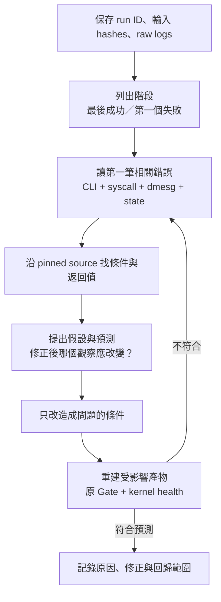

先保存失敗，不急著重跑覆蓋。每個 run 都有獨立目錄；真正重要的是同一份輸入、log 與 state snapshot 能對得起來。若錯把新 image 的 `.config` 當失敗當時設定，就可能追錯方向。

### 11.2 實際案例 A：CXL region 無法 commit

這是已保留日誌的失敗，run ID 為 `8b69519918954c22b893346bdef0b5c7`。日誌存在本機 `results/runs/<run_id>/`，不隨 Git 提交；以下保留足以理解原因的關鍵摘錄。

**症狀與階段：**Guest 已開機且能發現裝置，但 `cxl create-region` 在 commit decode 時失敗。`shared/topology.json` 的結果為 BLOCKED。這時還沒到匿名頁移動，更不是 policy 的問題。

```text
create-region: failed to commit decode: No such device or address
Failed to synchronize CPU cache state
WARNING: ... drivers/cxl/core/region.c:235
```

**追蹤：**先讀 [Linux 6.18.56 的 region.c](https://git.kernel.org/pub/scm/linux/kernel/git/stable/linux.git/tree/drivers/cxl/core/region.c?h=v6.18.56)，找到 `cxl_region_invalidate_memregion()`；再追 [x86 set_memory.c](https://git.kernel.org/pub/scm/linux/kernel/git/stable/linux.git/tree/arch/x86/mm/pat/set_memory.c?h=v6.18.56) 的 `cpu_cache_has_invalidate_memregion()`。在此版本與 x86 Hypervisor 條件下，核心拒絕該 cache invalidation 路徑，往上回傳 `-ENXIO`。

**假設與排除：**第一筆核心訊息直接指出 CPU cache state；來源中存在相符的 Hypervisor 條件與錯誤返回。單純增加 memory backend 大小不會改變這個條件。

**修正：**採用上游已有的 `CONFIG_CXL_REGION_INVALIDATION_TEST=y`，記錄於 [kernel.fragment](../configs/kernel.fragment)，重建 kernel 與 rootfs。這個選項是 QEMU 測試用 bypass；不提供實體 CPU cache 一致性證據，也不能作為實體裝置部署設定。其用途與限制須一起閱讀 [CXL Kconfig](https://git.kernel.org/pub/scm/linux/kernel/git/stable/linux.git/tree/drivers/cxl/Kconfig?h=v6.18.56)。

**驗證：**維持原來的 Guest identity、kernel health 與 topology 驗收，重新完成 region／DAX／online 與後續移頁。沒有關閉 WARNING 掃描，也沒有把 region commit 的失敗改成 PASS。

### 11.3 實際案例 B：頁已撤離、blocks 已 offline，轉回 devdax 卻失敗

失敗 run ID 為 `988c4639f1b34c04a1fb232a47a7cf07`。這個案例適合練習「整個 scenario 失敗」和「哪個階段失敗」的區別。

| 證據 | 當時觀察 | 排除／縮小的範圍 |
|---|---|---|
| `shared/drain.json` | C++ drain 成功，頁面撤回、mapping 已 release | 不能再把整體錯誤籠統歸為移頁失敗 |
| `shared/offline.json` | `memory42` 到 `memory49` 都已 offline | 失敗不是卡在某個 block 的 offline |
| `shared/offline.jsonl`／CLI | `daxctl reconfigure-device --mode=devdax dax0.0` 失敗 | 第一個失敗邊界是 DAX 模式切換 |
| `shared/dmesg.log` | 第一筆 WARNING 指向 `include/linux/memremap.h:227 dev_dax_probe` | 往 page map／驅動 probe／Kconfig 追 |
| 最終 report | `region_removed=false`、`dax_removed=false` | 系統沒有在失敗後繼續 destroy，沒有誤報 OFFLINE |

關鍵日誌摘錄：

```text
WARNING: CPU: 2 PID: 264 at include/linux/memremap.h:227 dev_dax_probe+0xd4/0x1b0
... dynamic-dax with pre-populated page map ...
... probe ... error -22 ...
daxctl: Invalid argument
```

依 stack 從 syscall 往子系統讀，主幹為：

```text
do_syscall_64 → ksys_write → vfs_write → kernfs_fop_write_iter
  → do_id_store → bus_for_each_dev → __driver_attach
  → driver_probe_device → __driver_probe_device → really_probe
  → dax_bus_probe → dev_dax_probe
```

**根因：**當時未啟用 `CONFIG_ZONE_DEVICE`，`include/linux/memremap.h` 對應的 stub 不能建立所需 page map，會觸發 WARNING 並回傳 `-ENXIO`。後續 probe 又因 pre-populated page map 走到 `-EINVAL`；CLI 最後回報 Invalid argument。這些是不同層、不同時點的錯誤，不能全部統一寫成 `errno=22`。

讀取本機釘版來源的命令：

```bash
sed -n '200,240p' build/sources/linux-6.18.56/include/linux/memremap.h
grep -n 'memremap\|pre-populated\|dev_dax_probe' \
  build/sources/linux-6.18.56/drivers/dax/device.c
grep -n 'CONFIG_ZONE_DEVICE\|CONFIG_DEV_DAX' configs/kernel.fragment
```

**修正與回歸：**在 [configs/kernel.fragment](../configs/kernel.fragment) 啟用 `CONFIG_ZONE_DEVICE=y`，不是增加重試或加 force。由於 kernel、modules 與 image provenance 都受影響，需要重建 kernel 和 rootfs：

```bash
make kernel BUILD_JOBS=2
make rootfs
make offline-test
make check
```

後續完整回歸的 G4 run `cc2fbb9c3c81413cbf0454b671f7e3bc` 完成 32768 頁撤離、8 個 blocks offline、devdax 切換與 region／DAX 移除，kernel health 通過。成功路徑沒有放寬原本的完整性與 query 條件。

### 11.4 常見症狀的分流表

以下是依目前防護與測試整理的排查情境；只有前兩個案例標為已發生的真實故障。本表不是每個情境都曾在真實 Guest 注入。

| 症狀 | 優先讀取與假設 | 修正方向與確認方式 |
|---|---|---|
| KVM `EACCES` | doctor errno、`id`、`ls -l /dev/kvm`；舊登入未取得群組 | 使用新登入程序取得 kvm 群組，再以一般使用者 probe；不改成 0666 |
| `Guest source changed; rebuild rootfs` | 比對 metadata 的 guest_inputs 與目前腳本 | `make rootfs`；不能刪除 hash 檢查測舊副本 |
| config audit 指出 symbol 不符合 | 最終 `.config`、Kconfig dependencies、merge log | 修正真正的相依；fragment 中寫了 y 不代表最後一定是 y |
| migration rc=0 卻有逐頁失敗 | status validity、`-EFAULT`／`-ENOENT`、query-after | 找出非法／未配置 VA；保留逐頁失敗與固定分母 |
| rc=-1 後 status 看似是 node 0 | sentinel 初始化、valid flag、原始 errno | 整批失敗不採信 move status；位置另讀 query |
| fast cap 超限 | promotion 前的實際 query、失敗 demotion | 只按已查得的 fast 頁數算容量，不預先釋出要求移出的頁 |
| `INVALID_RESIDENCY_WINDOW` | before/window_end、六項干擾 counters | 檢查 autobalancing、swap、回收或其他移頁來源；本輪不可照常評分 |
| phase shift 後 HFR 很高、AWFR 也被立即改高 | evaluator 使用 before 還是 after | 本輪 AWFR 固定讀 before；ready HFR 才讀 after |
| 缺 trace event | events enable、PID、marker 順序、CPU stats、最終 drain | 先判斷是否根本未進 migration，再判斷收集是否缺漏；有 loss 不能當完整證據 |
| offline 失敗、rollback 也不完整 | 失敗前 snapshot、本次已確認成功清單、最後全白名單狀態 | 保存 FAILED；只逆序恢復本次確認 offline 的 blocks，不繼續 teardown |
| syscall 卡在核心 | Host timeout、QMP／console、最後一個 marker | Guest deadline 無法取消卡住的 syscall；由 Host 結束本 VM，不另開平行重試 |
| heavy.lock 已被持有 | 是否已有本專案 builder／VM | 等待擁有者完成；刪除 lock 檔不等於釋放原 inode 上的鎖 |
| demo 在舊 PASS 後拒絕重播 | 當前 input SHA 與 gate 不符 | 對目前產物重跑受影響 gates，保留舊 run 作歷史證據 |

### 11.5 不同測試各負責哪一段

`migrator_tests` 用假 Invoke 驗證 syscall／sentinel／partial 結果；`policy_tests` 用 FakeMigrator 驗證容量、排序與重試；`drain_tests` 驗證 admission、容量與 deadline；Python MockSysfs 驗證逐 block／rollback 與 teardown 守門。它們能精準重現邊界，但不取代真實 Guest。

ASan 主要找越界、use-after-free 等執行期記憶體錯誤，UBSan 檢查部分未定義行為。兩者不會證明 NUMA placement 正確、trace 沒丟事件或 offline 安全。這些仍由 G0–G5 的真實證據與獨立 validator 負責。

<details>
<summary>自問：為什麼不能把已知 WARNING 加進 allowlist，讓實驗先過？</summary>

因為這裡的 WARNING 揭露實際不支援或不完整的核心路徑。忽略它只改變報告，不會建立所需 page map 或 cache invalidation 條件。應先追來源、修正可驗證的原因，再以同一份 health 規則重跑。

</details>

<a id="exercises"></a>

## 12. 自問自答與延伸練習

### 12.1 把三種圖分開畫

函式呼叫圖回答「誰呼叫誰」；資料流圖回答「哪些值被誰產生、交給誰使用」；狀態圖回答「哪些條件成立，物件才可以轉移」。例如 `PolicyCore::reconcile` 是函式，query-after 是輸入資料，頁面是否進入 cooldown 是狀態變化。三者若混在一張圖又不標箭頭意義，就很難判斷哪個結論有證據。

閱讀任一條路徑時，試著填一張追蹤卡：

| 欄位 | 以一次 promotion 為例 |
|---|---|
| 觸發條件 | Hot、在 slow、cooldown／backoff 到期、預算與 fast 容量皆足夠 |
| 所有者 | `policy_run` 控制流程；PolicyCore 決策；LinuxMigrator 執行 syscall |
| 輸入 | epoch、page IDs、target、query-observed nodes |
| 狀態變更 | 真正移動才更新 last_move；EBUSY 更新 retry_epoch |
| 失敗分支 | query 缺值、整批錯誤、逐頁錯誤、未填 sentinel |
| 觀察證據 | before／raw syscall／after、epoch JSONL、Host 重算 |
| 不能推論 | 不從要求數推成功數、不從彙總 trace 推逐 VA 位置 |

### 12.2 機制與邊界

<details>
<summary>Q1：node 1 一定比 node 0 慢嗎？</summary>

不是。ID 不是效能排序。本專案依 CXL range／sysfs 辨識角色，並把兩者稱為 fast／slow；QEMU 中的命名不提供真實硬體延遲差異。核心 memory-tier 分類還是另一個問題。

</details>

<details>
<summary>Q2：query 的某個 status entry 為 -ENOENT，能不能把這頁當成不在 fast，再繼續算 HFR？</summary>

不能。負值代表該 entry 沒有有效 node，不能默認為 slow，也不能從分母排除。先查 VA 是否已 fault-in、映射生命週期是否仍有效，並依驗收規則拒絕缺值。

</details>

<details>
<summary>Q3：syscall 整批失敗，但 query-after 顯示某頁已移動，怎麼記錄？</summary>

保留 rc=-1 與原 errno，把 move status 標成無效；若 before／after 都有效且證明實際位置已改變，可以據此更新該頁的移動時間。不能為了讓紀錄整齊，改寫 syscall 為成功，或假設所有頁都沒移動。

</details>

<details>
<summary>Q4：2048 attempts 和 8192 fast cap，哪個限制會先擋 promotion？</summary>

兩者獨立。候選數受剩餘 attempts、整輪已嘗試數、實際 fast 空間共同限制；哪個剩餘最少就先成為上限。失敗 demotion 不釋放空間，卻已消耗 attempts。

</details>

<details>
<summary>Q5：drain 有 60 秒 deadline，為什麼 Host 還要 timeout？</summary>

Guest 只能在 syscall 返回後再次檢查時間，無法在核心內卡住時強制讓同一 syscall 返回。Host 的 VM timeout 是外部停止界線，不是在 Guest 中啟動第二份 competing retry。

</details>

<details>
<summary>Q6：8 個 blocks 全 offline，但 destroy-region 失敗，可以標 OFFLINE 嗎？</summary>

不能。本專案的完整 OFFLINE 契約包含 devdax 模式、disable／destroy 與最終 region／DAX 不存在的確認。只能保留實際完成的步驟並回報 FAILED；也不能把 teardown 失敗寫成已完成整裝置 rollback。

</details>

<details>
<summary>Q7：trace 沒有看到非法 target 的 migration event，是收集器壞了嗎？</summary>

不一定。此負例預期在 target 驗證時就返回 ENODEV，尚未呼叫 migrate_pages，所以 markers 中間應沒有 migration events。需同時檢查 markers 成對、PID／run ID 正確、loss=0、syscall errno 與 query 不變，才能區別預期空白與遺失證據。

</details>

<details>
<summary>Q8：釘住 QEMU／Linux SHA256，為何仍不宣稱未來能重建同一個 rootfs？</summary>

Ubuntu apt repository 的套件內容沒有固定到 immutable snapshot。本版保存實際 image hash 與 package manifest，能辨認或重用已保存的映像；這和未來重新下載套件後可重建相同位元內容是不同保證。

</details>

### 12.3 三個可完成、範圍有限的練習

1. **手算 policy。**不執行 Guest，沿 `policy_tests.cpp` 的 `hysteresis_and_ranking()` 計算 count sequence 對 score／streak／class 的影響，再用 Host GDB 對照。交付一張表，解釋第幾輪首次 Hot、何時轉 Cold。
2. **追一個負例。**選 `mixed_va`，畫出 `do_pages_move()` 的合法頁排隊、非法 VA 寫 status、flush 與 final return。再把 raw JSONL、32-page trace 成功數和全 64 頁 query 對上；交付一張表，保留整批與逐頁兩種結果。
3. **做離線證據檢查。**在暫存資料中刪除一個 migration event，交給現有負例測試驗證拒絕。先讀 `tests/test_trace_evidence.py` 與 `trace_negative_controls()`；不修改原始 run，不把此合成反例標成真實核心漏事件。

R1 DAMON observer 與 R2 live offlining 是獨立後續實驗。前者要處理取樣與本版精確 counts 的差異；後者要處理並行 admission、停止存取、mapping lifetime 與撤離協調。開始前先寫清楚新的不變條件及驗證方式，不直接把目前成功路徑換個名稱。

<a id="references"></a>

## 13. 名詞、來源與文件維護

### 13.1 名詞速查

| 名詞 | 此教學的定義 |
|---|---|
| Host | 執行 QEMU 與 Python runner 的 WSL Ubuntu |
| Guest | QEMU 中的釘版 Linux／Ubuntu，所有 CXL／移頁／offline 操作目標 |
| placement／residency | 某頁在一次有效 kernel query 時觀察到的 node |
| policy metadata | 熱度、分類、streak、cooldown／backoff 時間；不是位置事實 |
| promotion／demotion | 依本專案角色把頁搬向 fast／slow；不等於核心自動 demotion 機制 |
| attempt | 對一個頁送出一次移動要求，失敗也計入預算 |
| sentinel | 預先放入 `INT_MIN`，表示狀態尚未知，不是合法 node |
| drain | 關閉 slow admission，將受管理頁搬回 fast、驗資料並解除 mapping |
| offline | 核心將指定 memory blocks 移出可配置記憶體；本專案還驗證後續 teardown |
| folio | 核心管理一個或多個連續 base pages 的單位 |
| tracepoint | 核心預先定義的觀測點；migration events 在此提供彙總資料 |
| marker | userspace 寫入 trace，標出 run／batch 的區間 |
| provenance | 來源、版本、hash 與產物之間的可追溯對應 |
| Gate | 由明確條件、原始證據與 validator 判定的驗收結果 |

### 13.2 閱讀來源的順序

介面說明看官方文件，實際分支看釘版 source，最後回到本次 raw evidence。線上 latest／master 文件可能已更新，不能直接把其中行號或行為套到 6.18.56／11.1.0。

| 主題 | 主要來源 |
|---|---|
| NUMA 的 node 模型 | [Linux：What is NUMA?](https://docs.kernel.org/mm/numa.html) |
| QEMU CXL 模型 | [QEMU CXL](https://www.qemu.org/docs/master/system/devices/cxl.html)；本機 `build/sources/qemu-11.1.0/docs/system/devices/cxl.rst` |
| move_pages 介面 | [Linux man-pages：move_pages(2)](https://man7.org/linux/man-pages/man2/move_pages.2.html) |
| 精確 migration 分支 | [Linux v6.18.56：mm/migrate.c](https://git.kernel.org/pub/scm/linux/kernel/git/stable/linux.git/tree/mm/migrate.c?h=v6.18.56) |
| migration trace 格式 | [Linux v6.18.56：include/trace/events/migrate.h](https://git.kernel.org/pub/scm/linux/kernel/git/stable/linux.git/tree/include/trace/events/migrate.h?h=v6.18.56)；每 run 保存的 `.format` |
| Event／PID filter | [Kernel Event Tracing](https://docs.kernel.org/trace/events.html) |
| Instance／trace_pipe／stats | [Kernel ftrace](https://docs.kernel.org/trace/ftrace.html) |
| GDB stepping／stack | [GDB stepping](https://sourceware.org/gdb/current/onlinedocs/gdb.html/Continuing-and-Stepping.html)、[Backtraces](https://sourceware.org/gdb/current/onlinedocs/gdb.html/Backtrace.html) |
| GitHub 圖表 | [GitHub：Creating diagrams](https://docs.github.com/en/get-started/writing-on-github/working-with-advanced-formatting/creating-diagrams) |

### 13.3 範例與實測的標示

完整實測基準為 2026-11-06（台灣時間），版本與 build inputs 見 [versions.lock.json](../configs/versions.lock.json)，每 run 另存 hashes。文中的小型算例是解釋用的模型；標成 FakeMigrator、MockSysfs 或 modeled 的反例，不代表對真實核心做過同等故障注入。指令旁的預期結果是驗收條件，實際是否通過須以執行後報告為準。

`results/`、`build/`、`images/`、`.paef/reports/` 是本機產物，不隨 Git 提交。上傳原始碼後，讀者仍能閱讀本文的 log 摘錄、程式碼與圖表；完整 raw evidence 需依建置步驟自行產生。本教學不依賴私人絕對路徑、對話紀錄或登入憑證。

### 13.4 維護方式

修改說明時先改 `docs/cxl-mm-tutorial.md`，並核對來源函式、參數與測試名稱。圖表的 Mermaid 原始碼與正文一起保存在 Markdown；HTML 是同一份文件的閱讀版本，所有 SVG 已預先渲染。專案執行與驗收不依賴文件渲染工具。

只有要重新產生 HTML 時才需要以下工具；直接在 GitHub 閱讀 Markdown 或開啟既有 HTML 都不需安裝。渲染工具放在忽略的 `build/` 內，不加入專案執行相依：

```bash
mkdir -p build/docs-qa
python3 -m venv build/docs-qa-venv
build/docs-qa-venv/bin/python -m pip install Markdown==3.11.3 playwright==1.64.1
build/docs-qa-venv/bin/python -m playwright install chromium
python3 - <<'PY'
from urllib.request import urlretrieve
urlretrieve("https://cdn.jsdelivr.net/npm/mermaid@11.12.1/dist/mermaid.min.js",
            "build/docs-qa/mermaid.min.js")
PY
build/docs-qa-venv/bin/python docs/render.py \
  --mermaid-js build/docs-qa/mermaid.min.js
```

[docs/render.py](render.py) 使用本機 Mermaid bundle 預先渲染 SVG，再產生單一 HTML；HTML 的 `source-sha256` metadata 記錄當次 Markdown hash，用來辨識內容是否同步。Chromium 若缺少系統函式庫，需先依 Playwright 的缺項訊息補齊，這只影響文件渲染，不影響閱讀或專案驗收。

若程式行號變動，以函式名稱搜尋為準。若改變 profile、syscall 語意或 lifecycle，需同時更新圖表與預期結果；不得只修改教學的數字以符合一份失敗結果。
